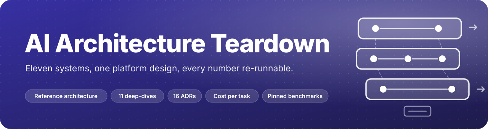
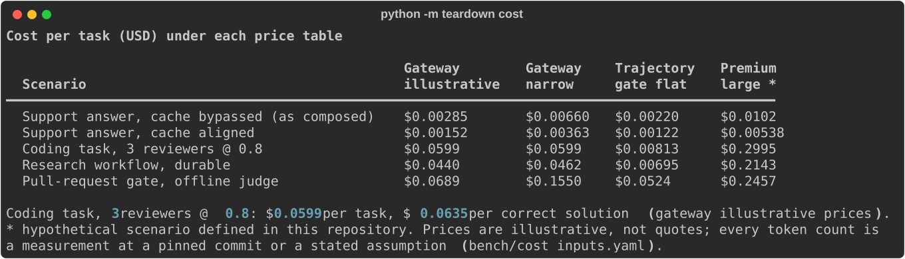
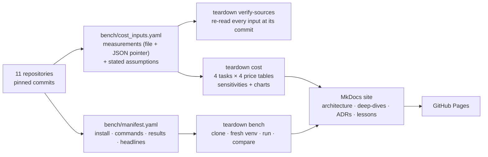
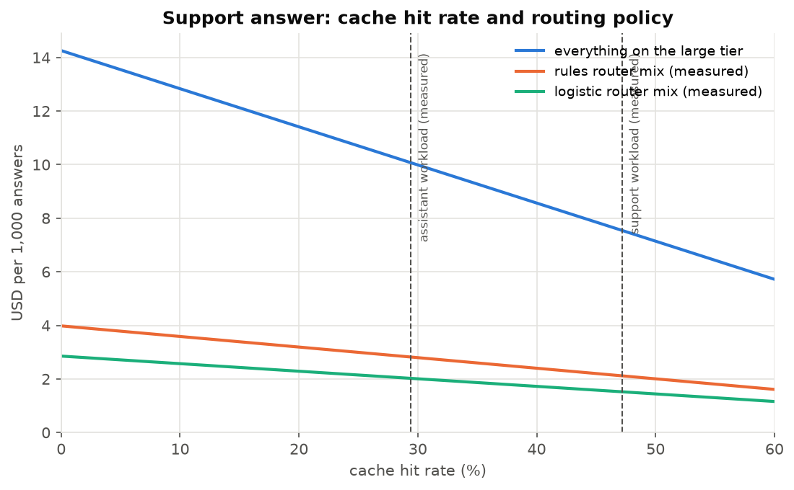

<p align="center">
  
</p>

<p align="center">
  <a href="https://github.com/iamsammy-ak/ai-architecture-teardown/actions/workflows/ci.yml"></a>
  <a href="https://github.com/iamsammy-ak/ai-architecture-teardown/actions/workflows/pages.yml"></a>
  
  <a href="https://iamsammy-ak.github.io/ai-architecture-teardown/"></a>
  
  <a href="LICENSE"></a>
</p>

**AI Architecture Teardown** takes eleven AI-engineering systems I built as separate repositories (a cache gateway,
a security proxy, a context assembler, agent memory, three retrieval systems, a multi-agent swarm, a durable
workflow runtime, an MCP tool server and a trajectory eval gate) and reviews them as one platform design: how they
would compose, why each was built the way it was, what a task costs on it, and how to re-run every number. Every
claim links to the exact lines or results file at a pinned commit.

**Read it as a site: [iamsammy-ak.github.io/ai-architecture-teardown](https://iamsammy-ak.github.io/ai-architecture-teardown/)**



## Why this exists

A portfolio of eleven repositories shows that each component works. It does not show whether their author can
design a system: where the trust boundaries go, which component owns which failure, what the platform costs per
task, which decisions recur and why, and what is still missing before the parts could run together. This repository
answers those questions in public, with the same rule the components follow: nothing is claimed that a results file
at a pinned commit, or a stated assumption, does not back.

It is also deliberately honest about scope. The eleven systems are **independent**; they have never served a
request together, and every number was measured with deterministic stand-ins for language models on mostly
synthetic data. The site says so on every page where it matters.

## What is inside

| | |
|---|---|
| 🏗️ **Reference architecture** | The request path, trust boundaries, where state lives, a failure-mode table with the component that handles each, and an honest list of integration seams |
| 🔬 **Eleven deep-dives** | Problem, diagram, key mechanisms with code excerpts linked to exact lines at the pinned commit, measured results, trade-offs, failure modes, what I would change at scale |
| 🕸️ **Swarm topologies** | Supervisor (as implemented) vs peer debate, hierarchical, pipeline and blackboard; the typed hand-off contract; what the benchmark showed about reviewer count, debate and correlated errors |
| 💶 **Cost per task** | A Python model of four tasks priced under four tables, with cache, routing, reviewer and crash sensitivities; every input measured or stated as an assumption |
| 🔁 **Reproducible benchmarks** | A pinned manifest and a runner that clones each repository at its commit, installs it into a fresh venv, runs the benchmark and compares headline numbers with the committed ones |
| 📜 **16 ADRs** | MADR records of decisions actually made in the repositories, from explicit state machines to hash-chained audit logs |
| 🧭 **Lessons** | What the benchmarks show together, where the numbers are synthetic, and what would come next with real traffic |

## How it works



1. **Pin.** `bench/manifest.yaml` pins every repository to a full commit SHA and records how to install it, how to
   run its benchmark in a fast and a full mode, which files it writes and which numbers matter.
2. **Measure, or say it is assumed.** `bench/cost_inputs.yaml` lists every number the cost model uses. A measurement
   names its repository, file and JSON pointer (or a derivation such as a mean over a JSONL log); an assumption
   carries the reason for its value. `teardown verify-sources` re-reads all of them at the pinned commits.
3. **Model.** `teardown cost` prices four tasks (support answer, coding task, research workflow, pull-request gate)
   under four price tables and writes the tables and charts the site includes. A test fails if the committed tables
   are stale.
4. **Reproduce.** `teardown bench` clones a repository at its commit, verifies `HEAD`, creates a fresh virtual
   environment, installs it, runs the benchmark with API keys removed, and compares the fresh headline numbers with
   the committed ones.
5. **Publish.** The site is built with `mkdocs build --strict` (broken links and anchors fail the build) and deployed
   to GitHub Pages on every push to `main`.

## The eleven systems

| System | What it does | Headline (measured, pinned commit) |
|---|---|---|
| [Semantic cache gateway](https://iamsammy-ak.github.io/ai-architecture-teardown/systems/semantic-cache-gateway/) · [repo](https://github.com/iamsammy-ak/semantic-cache-gateway/tree/b8b77e02b5ed88b329e3af6652060544bd4aeb57) | OpenAI-compatible gateway: exact + guarded semantic cache, tiered routing, budgets, fallbacks | 73.2% cheaper than "large model, no cache"; 0.4% wrong semantic hits with guard rails vs 29.5% without (synthetic, illustrative prices) |
| [Inter-agent security proxy](https://iamsammy-ak.github.io/ai-architecture-teardown/systems/inter-agent-security-proxy/) · [repo](https://github.com/iamsammy-ak/inter-agent-security-proxy/tree/d2ad5b5b66bc524c70a2d14d5d7b3097109062fa) | PII tokenisation, injection screening, least-privilege tool policy, hash-chained audit | Injection F1 0.924 on the public deepset test split; PII F1 0.969 at precision 1.000 (synthetic) |
| [Context assembler engine](https://iamsammy-ak.github.io/ai-architecture-teardown/systems/context-assembler-engine/) · [repo](https://github.com/iamsammy-ak/context-assembler-engine/tree/1f7863ceab66f865fa5e69ff1d0806df8ed260fb) | Allocates a verified token budget across eight prompt slots | 88.6% fact retention and 0 / 320 budget violations vs 66.2% for a fixed split (synthetic) |
| [Three-tier agent memory](https://iamsammy-ak.github.io/ai-architecture-teardown/systems/three-tier-agent-memory/) · [repo](https://github.com/iamsammy-ak/three-tier-agent-memory/tree/cf1aea0cbaf79a991cd3bd69612a435518dd6441) | Working, episodic and semantic memory with versioned facts | Stale@5 0.224 vs 0.776 for a flat vector store, with 1/8 of the items (synthetic) |
| [Hybrid rerank retrieval](https://iamsammy-ak.github.io/ai-architecture-teardown/systems/hybrid-rerank-retrieval/) · [repo](https://github.com/iamsammy-ak/hybrid-rerank-retrieval/tree/8c7300d8a31f79088883937bfe4a6352ceeeb9a7) | BM25 + dense + fusion + cross-encoder + typed filters | Hybrid RRF nDCG@10 0.718 / Recall@100 0.968 on BEIR SciFact vs 0.677 / 0.912 BM25 and 0.713 / 0.942 dense, for +0.9 ms p95; a cross-encoder rerank lowered nDCG@10 to 0.706 at +1.6 s |
| [GraphRAG knowledge pipeline](https://iamsammy-ak.github.io/ai-architecture-teardown/systems/graphrag-knowledge-pipeline/) · [repo](https://github.com/iamsammy-ak/graphrag-knowledge-pipeline/tree/21dc6d17dbd5fbc6ef827b8963c6a746f644b96e) | Cited knowledge graph from text; relation-aware multi-hop search | Full support@5 0.75 vs 0.19 for vector search (synthetic, held-out questions) |
| [Self-correcting agentic RAG](https://iamsammy-ak.github.io/ai-architecture-teardown/systems/self-correcting-agentic-rag/) · [repo](https://github.com/iamsammy-ak/self-correcting-agentic-rag/tree/e84144b098876e7718e2e5e5c1043c02fe045298) | Plan, retrieve, grade, verify every claim, abstain when unsure | Wrong answers 4.3% vs 27.5% for naive RAG (synthetic, no LLM) |
| [Typed multi-agent swarm](https://iamsammy-ak.github.io/ai-architecture-teardown/systems/typed-multi-agent-swarm/) · [repo](https://github.com/iamsammy-ak/typed-multi-agent-swarm/tree/37b44ec34961f5d3879863a284f203e79d06c1c3) | Supervisor state machine, typed hand-offs, consensus, veto, grounded debate | 97.9% accepted-solution correctness with 3 reviewers @ 0.8 vs 62.0% for a single coder (simulated competence, real execution) |
| [Durable agent state machine](https://iamsammy-ak.github.io/ai-architecture-teardown/systems/durable-agent-state-machine/) · [repo](https://github.com/iamsammy-ak/durable-agent-state-machine/tree/5facc0f0b769a2e68a57b8601f0730d9f8d4382f) | Journal-backed workflows: leases, fencing, timers, human gates, outbox | 0 duplicate publications under 200 real worker kills vs 10 with direct calls |
| [Raw MCP tool server](https://iamsammy-ak.github.io/ai-architecture-teardown/systems/raw-mcp-tool-server/) · [repo](https://github.com/iamsammy-ak/raw-mcp-tool-server/tree/1cfc10ed5a7f643fada223d85b4e6b3bbf660dab) | Model Context Protocol from JSON-RPC up: scopes, jail, sandbox, audit | 0 crashes in 10,000 fuzz cases; 1.1 ms vs 4.0 ms per call for the official SDK server |
| [Trajectory eval gate](https://iamsammy-ak.github.io/ai-architecture-teardown/systems/trajectory-eval-gate/) · [repo](https://github.com/iamsammy-ak/trajectory-eval-gate/tree/3921ccec986ce71b8922398b69a055b9217073cb) | Grades agent runs against partial-order DAGs; blocks regressing PRs | 100% of seeded regressions blocked vs 55.3% for outcome-only grading (synthetic) |

## Benchmarks

### Cost per task

Generated by `python -m teardown cost` from [`bench/cost_inputs.yaml`](bench/cost_inputs.yaml); full tables in
[`bench/results/cost_model.md`](bench/results/cost_model.md).

| Task (gateway illustrative prices) | USD per task | Driven by |
|---|---:|---|
| Support answer, cache bypassed (as composed today) | $0.00285 | Routing mix: everything on the large tier would be $0.0143 |
| Support answer, cache aligned (47.2% hit rate) | $0.00152 | The RAG generator's temperature (0.1) must drop to the gateway's cache cap (0.0) |
| Coding task, 3 reviewers @ 0.8 | $0.0599 ($0.0635 per correct solution) | Agent calls per task (measured 9.1) on the large tier |
| Research workflow, durable | $0.0440 | One 8,192-token draft on the large tier |
| Pull-request gate, offline judge | $0.0689 | 20 agent runs per PR (15 candidate + 5 amortised baseline) |



Assumptions: prices are the repositories' illustrative tables (not quotes) plus one hypothetical scenario labelled
as such; token counts are measured where a repository measures them (swarm calls and payloads, RAG rewrite rounds,
the assembler's fact-retention budget, the travel-desk agent's simulated usage) and stated assumptions otherwise
(answer lengths, system-prompt sizes, consolidation calls). No live model was called.

### Reproduced runs

`python -m teardown bench --fast --only trajectory-eval-gate,durable-agent-state-machine`, run locally: both
repositories cloned from GitHub at their pinned commits, installed into fresh virtual environments and benchmarked
([`bench/results/summary.md`](bench/results/summary.md)).

| Repository | Mode | Status | Headline: fresh vs committed |
|---|---|---|---|
| trajectory-eval-gate @ `3921cce` | fast (= full) | passed, 329 s | regressions blocked 100% vs 100%; outcome-only 55.3% vs 55.3%; benign blocked 16.5% vs 16.5% |
| durable-agent-state-machine @ `5facc0f` | fast (12 runs, 6 kills) | passed, 226 s | runs as expected 1.0 vs 1.0; outbox duplicates 0 vs 0 (small fast run: not comparable to the 200-kill full run) |

## Architecture decision records

| ADR | Decision |
|---|---|
| [0001](docs/adr/0001-explicit-state-machines.md) | Explicit state machines instead of an agent framework |
| [0002](docs/adr/0002-offline-first-stand-ins.md) | Offline-first: deterministic stand-ins for every model-backed component |
| [0003](docs/adr/0003-sqlite-wal-durable-store.md) | SQLite in WAL mode as the durable store |
| [0004](docs/adr/0004-transactional-outbox.md) | Transactional outbox and idempotency keys for side effects |
| [0005](docs/adr/0005-leases-with-fencing.md) | Leases with fencing tokens for run ownership |
| [0006](docs/adr/0006-partial-order-trajectory-specs.md) | Partial-order golden DAGs for grading agent trajectories |
| [0007](docs/adr/0007-guard-rails-over-similarity-threshold.md) | Guard rails on top of the similarity threshold for semantic caching |
| [0008](docs/adr/0008-mcp-without-sdk.md) | Implement the Model Context Protocol from the JSON-RPC layer up |
| [0009](docs/adr/0009-hmac-pii-tokens.md) | Session-scoped HMAC tokens for personal data, rehydrated only at the tool boundary |
| [0010](docs/adr/0010-versioned-facts.md) | Versioned facts with validity intervals: supersede, never overwrite |
| [0011](docs/adr/0011-hash-chained-audit-log.md) | Hash-chained, HMAC-signed audit logs as append-only files |
| [0012](docs/adr/0012-verified-token-budget.md) | Verify the rendered prompt with the real tokenizer, then repair |
| [0013](docs/adr/0013-typed-handoffs-bounded-repair.md) | Typed hand-offs with bounded, budgeted repair |
| [0014](docs/adr/0014-security-veto-and-grounded-debate.md) | A security veto and evidence-grounded debate in reviewer consensus |
| [0015](docs/adr/0015-exact-search-at-small-scale.md) | Exact, partitioned search instead of an approximate vector index |
| [0016](docs/adr/0016-rank-fusion-over-score-mixing.md) | Rank fusion instead of mixing raw scores |

## Quick start

```bash
git clone https://github.com/iamsammy-ak/ai-architecture-teardown.git
cd ai-architecture-teardown
python -m venv .venv
source .venv/bin/activate              # Windows: .venv\Scripts\activate
pip install -e ".[dev]"

python -m teardown cost                # cost model: tables in bench/results/, charts in docs/assets/charts/
python -m teardown verify-sources      # re-read every measured input from GitHub at its pinned commit
python -m teardown manifest            # validate and list the pinned manifest
python -m teardown bench --dry-run --model-free
python -m teardown bench --only trajectory-eval-gate     # clone, fresh venv, install, run, compare (~6 min)
mkdocs serve                           # the site at http://127.0.0.1:8000
```

Without installing, `PYTHONPATH=src python -m teardown ...` runs the same commands. No API key is needed or used:
the runner removes `OPENROUTER_API_KEY` and similar variables before running any benchmark. `verify-sources`
and `bench` need network access to GitHub (and to PyPI for installs); `verify-sources --local <dir>` reads local
clones instead.

## Use it as a library

```python
from teardown.cost import Knobs, coding_task, estimate, support_answer
from teardown.inputs import load_inputs

inputs = load_inputs()  # bench/cost_inputs.yaml: measurements at pinned commits + stated assumptions

task = support_answer(inputs)
for hit_rate in (0.0, inputs.value("gateway.support.hit_rate.exact_semantic")):
    knobs = Knobs(price_table="gateway-illustrative", cache_hit_rate=hit_rate, router="logistic")
    print(f"support answer, cache hit rate {hit_rate:.0%}: ${1000 * estimate(task, knobs, inputs).usd:.2f} per 1,000")

swarm = estimate(coding_task(inputs, reviewers=1, accuracy=0.8), Knobs(price_table="gateway-illustrative"), inputs)
print(f"coding task, 1 reviewer @ 0.8: ${swarm.usd:.4f} per task, ${swarm.usd_per_success:.4f} per correct solution")
```

```text
support answer, cache hit rate 0%: $2.85 per 1,000
support answer, cache hit rate 47%: $1.52 per 1,000
coding task, 1 reviewer @ 0.8: $0.0275 per task, $0.0320 per correct solution
```

The same script is [`examples/price_a_task.py`](examples/price_a_task.py).

## Design decisions

- **Every number is a measurement with a locator, or an assumption with a reason.** The alternative, a spreadsheet
  of figures copied from READMEs, drifts silently when a repository changes. Here each measured input names a file
  and a JSON pointer at a pinned commit, `verify-sources` re-reads it, and a test fails if the committed tables no
  longer match the inputs.
- **Pin full commit SHAs and verify `HEAD` after checkout.** Tags and branches move; a benchmark of a newer commit is a
  different benchmark. The runner refuses to continue if the checkout is not exactly the pinned SHA.
- **A fresh virtual environment per repository, keys stripped.** Running everything in one environment would let one
  repository's dependencies satisfy another's undeclared import, and a stray key could switch a benchmark to a paid
  model. The cost is install time: most of a fast run is `pip install`.
- **Compare fresh headline values with the committed ones at the same commit, and say when they should agree.** A
  fast run uses smaller settings and is a smoke test; only a deterministic benchmark run with the full settings is
  expected to reproduce exactly, and the summary labels which is which.
- **Simple diagrams over complete ones.** The first version of the platform diagram had every subgraph and back-edge
  and rendered unreadably small; the published one drops the subgraphs and keeps the request path, with the detail
  moved into tables (trust boundaries, failure modes, seams).
- **Generate the site's numbers, never type them.** The cost tables on the site are included from generated files
  (`pymdownx.snippets`), so the page and the model cannot disagree.

## Project structure

```
ai-architecture-teardown/
├── src/teardown/
│   ├── manifest.py     pinned manifest: models, validation, GitHub URLs
│   ├── inputs.py       cost-model inputs: price tables, measurements, assumptions
│   ├── sources.py      JSON pointers, derivations, re-reading inputs at pinned commits
│   ├── cost.py         tasks, pricing, routing mixes, crash model, sensitivities
│   ├── report.py       tables (JSON + Markdown fragments) and chart orchestration
│   ├── charts.py       matplotlib charts (white background)
│   ├── runner.py       clone → venv → install → run → collect → compare
│   └── cli.py          python -m teardown {cost,bench,manifest,verify-sources}
├── bench/
│   ├── manifest.yaml       11 repositories, pinned commits, modes, results, headlines
│   ├── cost_inputs.yaml    every number the cost model uses
│   └── results/            cost tables, manifest table, runner summary and collected result files
├── docs/                   the MkDocs site (architecture, systems/, adr/, cost, benchmarks, lessons)
├── examples/               price_a_task.py
├── tests/                  pytest + hypothesis; the docs build is tested too
├── .github/workflows/      ci.yml · pages.yml (GitHub Pages) · reproduce.yml (manual)
└── mkdocs.yml
```

## Testing

```bash
ruff check . && mypy && pytest -q
```

108 tests run offline in about 25 seconds. They cover manifest validation (bad SHAs, unpublished repositories with a
commit, headline files outside the declared results, path traversal in result paths), JSON-pointer resolution with a
Hypothesis round-trip over keys containing `/` and `~`, the derivations and source verification against a fake
fetcher, the cost model (hand-calculated prices, cache discounts only on cacheable calls, closed forms of the crash
model checked against each other and property-tested), the runner with a fake `git` and a fake executor (success,
install and benchmark failures, missing results, wrong checkout, unpublished repositories, timeouts, no machine paths
in records), that the committed tables match the current inputs, that every docs link to a repository uses its
pinned commit, that every ADR follows MADR, and a strict MkDocs build. CI runs ruff, mypy and pytest on Python 3.10
and 3.12, and builds the site.

## Limitations

- **Not integrated.** The eleven systems are independent repositories; the reference architecture is a design, and
  its [integration seams](https://iamsammy-ak.github.io/ai-architecture-teardown/architecture/#integration-seams)
  section lists what would have to change.
- **No live-LLM numbers.** Every component benchmark used deterministic stand-ins; the cost model's token counts are
  measured payloads, simulated usage, budgets or assumptions, not provider usage fields.
- **Synthetic data.** Nine of the eleven benchmarks run on data I wrote; only the proxy's injection test split and
  the BEIR datasets are public.
- **Fusion settings were swept on the test split.** Hybrid rerank's RRF `k` and convex `alpha` sweeps on SciFact show
  sensitivity, not tuned results; the defaults were fixed before the sweep.
- **Fast runs are smoke tests.** Only deterministic benchmarks run with full settings are expected to reproduce the
  committed numbers exactly; model- and data-heavy full runs are documented, not run in CI.

## Roadmap

- [ ] Choose hybrid rerank's fusion setting and reranker on a held-out split and report the SciFact test score once
- [ ] Make model endpoints configurable across the repositories and run one request end to end through the gateway, proxy and agentic RAG
- [ ] Replace assumed token counts with provider usage from live-model runs on the same benchmark splits
- [ ] Run the full deterministic benchmarks on a schedule and publish the reproduction summary on the site

## License

[MIT](LICENSE) © 2026 Abhishek Kumar
