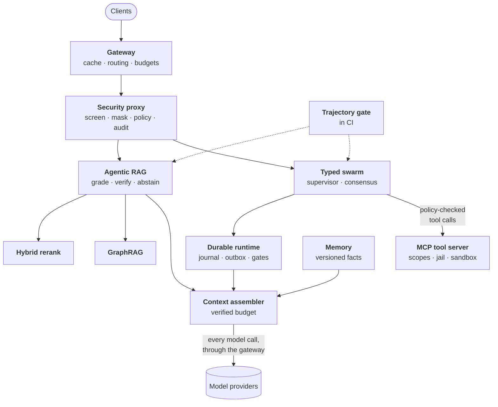
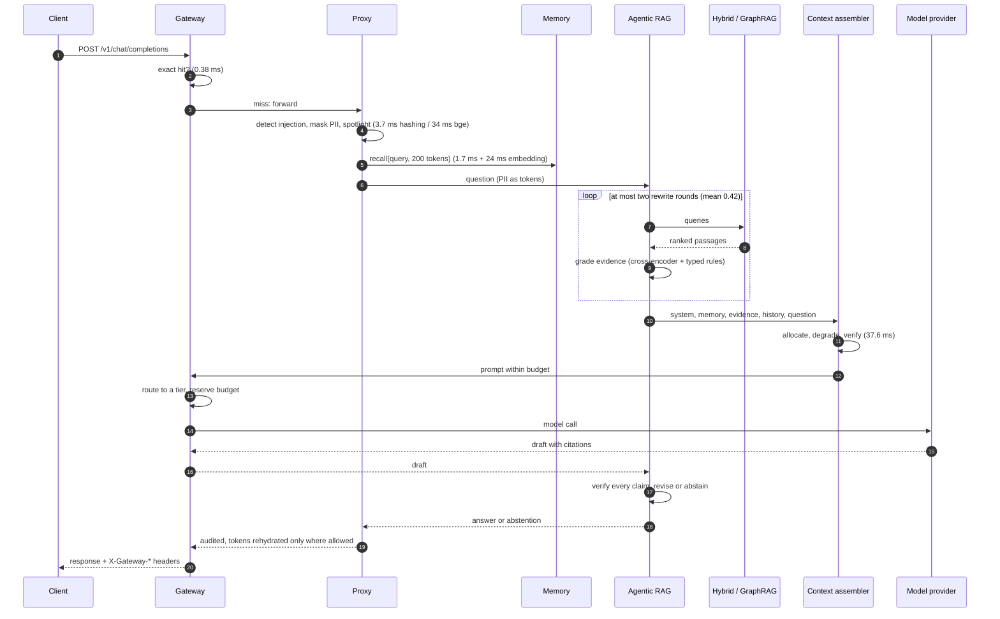
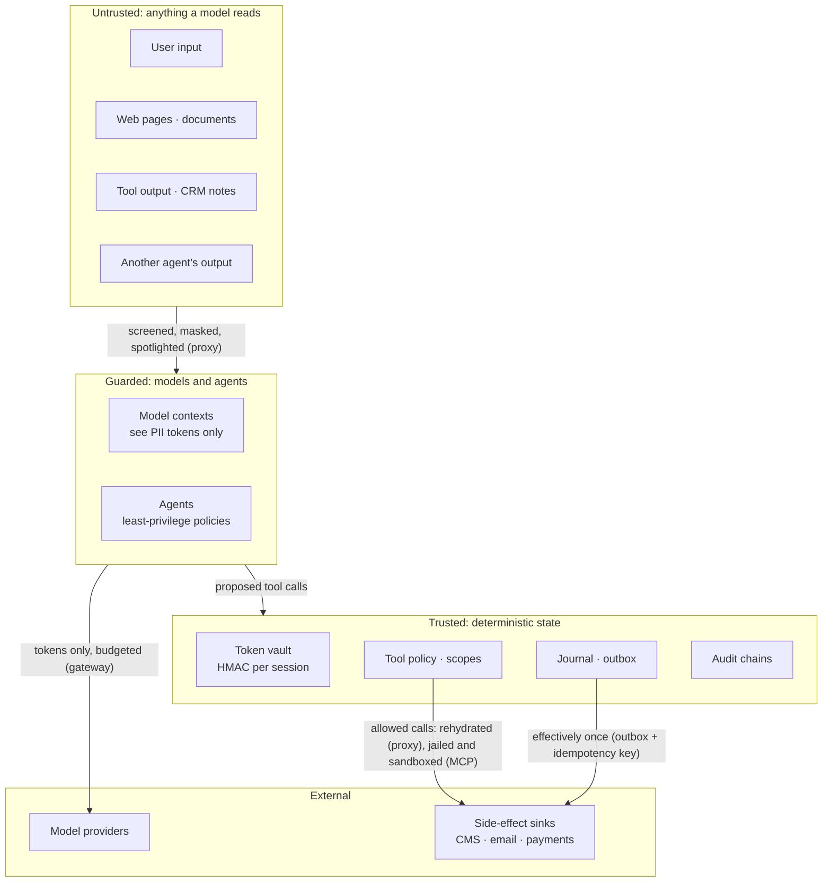

# Reference architecture

!!! warning "Composable, not integrated"
    The eleven systems are **independent repositories**. None imports another, no test exercises two of them
    together, and the request path below has never served a request end to end. This page is the design they were
    built towards: what each one would own in a production agent platform, where the trust boundaries fall, how
    failures are contained, and, in [Integration seams](#integration-seams), exactly what would have to change to
    wire them together. Where two systems disagree today, the page says so.

## The platform on one page

Read it top to bottom: a request enters through the **gateway**, crosses the **proxy** (the only component allowed to
see raw personal data and to decide what an agent may do), is answered by **agentic RAG** for question-shaped work or
by the **swarm on the durable runtime** for multi-step work, and every model call goes back out through the
gateway, with its prompt built by the **context assembler** from **memory** and **retrieval**. Tools are reached only
through the **MCP server**, and only after the proxy's policy allowed the call. The **trajectory gate** sits in CI,
not in the request path.

## The request path

A support question, as it would flow through the composed platform. Times are the measured medians of each
component on its own benchmark (busy laptop CPU, non-LLM work only); they are indicative, not an end-to-end
measurement.

Two details matter. The gateway is used twice: once at the edge, and once for the model call the RAG pipeline makes
(it is the egress point for every model call, which is where budgets and fallbacks belong). And the proxy never
returns raw personal values to a model context; values are rehydrated only into the arguments of an allowed tool call
([ADR-0009](adr/0009-hmac-pii-tokens.md)).

Multi-step work takes the agent plane instead: the proxy hands the task to the swarm's supervisor, each phase runs as
a durable activity so a crash re-runs one step rather than the task, agent hand-offs cross the proxy (one agent's
output is untrusted input to the next), and tool calls reach the MCP server only after the proxy's policy check.

## Trust boundaries

| Boundary | What crosses it | What checks it | Where it is enforced |
|---|---|---|---|
| Untrusted text → model context | Injections, hidden Unicode, personal data | Rules + classifier; PII masking; spotlighting | [Proxy](systems/inter-agent-security-proxy.md) |
| Model → tool | Proposed tool calls | Deny-by-default policy on tools, arguments, destinations and budgets; then scopes, jail, egress allowlist, sandbox | [Proxy](systems/inter-agent-security-proxy.md), then [MCP server](systems/raw-mcp-tool-server.md) |
| Agent → agent | Typed artifacts | Pydantic validation with bounded repair; screening as untrusted input | [Swarm](systems/typed-multi-agent-swarm.md), [proxy](systems/inter-agent-security-proxy.md) |
| Platform → provider | Prompts with PII tokens, spend | Budgets reserved before the call, circuit breakers, timeouts | [Gateway](systems/semantic-cache-gateway.md) |
| Workflow → outside world | Side effects | Outbox committed with the step; idempotency key at the sink | [Durable runtime](systems/durable-agent-state-machine.md) |
| Change → production | Agent code and prompts | Trajectory grading against golden DAGs with flaky-aware statistics | [Trajectory gate](systems/trajectory-eval-gate.md) |

The design principle is that **detection is probabilistic and enforcement is not**. The proxy's classifier misses
paraphrased social engineering; the tool policy does not care whether the model was fooled, because a call outside
the policy is refused either way. The same split appears in the RAG verifier (relevance is a score, the numbers and
negation check is exact) and the gateway (similarity is a score, the guard rails are exact).

## Where state lives

| State | Owner | Store | Durability | Scope |
|---|---|---|---|---|
| Response cache, budgets, breaker state | Gateway | Process memory | Lost on restart | Per tenant |
| PII token vault, session budgets | Proxy | Process memory | Lost on restart | Per session |
| Audit trail (proxy, MCP) | Proxy, MCP server | JSON Lines, hash-chained (proxy) | Append-only file | Global |
| Facts, episodes, scratchpads | Memory | SQLite, vectors as BLOBs | Transactional | Per user namespace |
| Workflow journal, checkpoints, signals, outbox | Durable runtime | SQLite in WAL mode | Survives process crashes | Per run |
| Swarm state, routing log | Swarm | Process memory (typed `SwarmState`) | Lost on crash unless run on the durable runtime | Per task |
| Golden DAGs, baselines | Trajectory gate | YAML + JSONL in the repository | Versioned with the code | Per eval case |

Two stores are durable and transactional (memory and the runtime, both SQLite, [ADR-0003](adr/0003-sqlite-wal-durable-store.md));
everything on the hot path is in memory. That is fine for single-host prototypes and is the first thing to change
at scale (see [lessons](lessons.md)).

## Failure modes and where each is handled

| Failure | Detected by | Contained by | Measured where |
|---|---|---|---|
| Provider outage or 429 storm | Gateway circuit breakers, per-hop timeouts | Same-tier fallback → cheaper tier (flagged, not cached) → stale cache → 503 | Gateway chaos run: availability 87.3% → 98.8% |
| Budget overrun by concurrent requests | Gateway reservation | Reserve worst case before the call, settle after | Gateway unit tests |
| Near-duplicate prompt served the wrong cached answer | Guard rails on numbers, entities, negation | Veto the hit; residual 0.4% | Gateway threshold sweep |
| Prompt injection in tool output | Proxy rules + classifier | Spotlighting; tool policy refuses out-of-policy calls regardless | Proxy injection benchmark and demo |
| Personal data reaching a provider | Proxy validators (Luhn, mod-97, checksums) | HMAC tokens; rehydration only at allowed tool calls | Proxy PII benchmark |
| Prompt over the context window | Context assembler exact re-count | Deterministic overflow repair | 0 / 320 violations |
| Stale fact recalled | Memory supersession | Validity intervals; masked episode text | Stale@5 0.224 (0.000 where extraction succeeded) |
| Confident wrong answer | RAG grader + verifier | Revise, or abstain under a fitted risk threshold | Wrong answers 27.5% → 4.3% |
| Malformed agent output | Swarm hand-off validation | Field-level repair, bounded, charged to budget | Swarm benchmark (5% malformed replies) |
| Insecure code approved by majority | Security reviewer | Veto | 20.4% → 5.4% insecure approvals |
| Runaway agent loop | Swarm budget guard; RAG `MAX_STEPS` | Stop before the phase that would exceed the budget | Property test: budget never exceeded |
| Worker crash mid-workflow | Lease expiry | Another worker resumes from the checkpoint; fencing stops the stale worker | 200 kills, 756 runs, 0 lost |
| Duplicate side effect after a crash | Idempotency key at the sink | Outbox + idempotent receiver | 0 vs 10 duplicate publications |
| Path traversal, SSRF, sandbox escape via a tool | MCP jail, egress checks, sandbox | Refuse before the operation | 21 / 21 attack scenarios contained |
| Agent behaviour regresses after a change | Trajectory grading | PR blocked; flaky cases need a significant drop | 100% of seeded regressions blocked |

## Integration seams

What would connect the systems today, and what would not. This is the honest list a design review should start
from.

| Seam | Status | Detail |
|---|---|---|
| Any component → gateway | **Adapter needed** | Gateway and proxy speak OpenAI-compatible `/v1/chat/completions`, but every repository hard-codes `OPENROUTER_BASE_URL` as a module constant. A configurable base URL (one line per repository) would route all model calls through the gateway. |
| Agentic RAG → gateway cache | **Mismatch** | The RAG generator calls the model at `temperature=0.1` ([`generate.py` L187](https://github.com/iamsammy-ak/self-correcting-agentic-rag/blob/e84144b098876e7718e2e5e5c1043c02fe045298/src/agentic_rag/generate.py#L187)); the gateway caches only at or below `cache.max_temperature`, 0.0 by default ([`gateway.py` L126-L129](https://github.com/iamsammy-ak/semantic-cache-gateway/blob/b8b77e02b5ed88b329e3af6652060544bd4aeb57/src/cache_gateway/gateway.py#L126-L129)). Composed as is, the cache never serves RAG answers. The [cost model](cost.md) prices both cases. |
| Swarm → gateway cache | **By design, no cache** | Swarm agents use `temperature=0.2` and each task is new; caching would not help and is not assumed. |
| Trajectory gate → gateway cache | **Must stay off** | Eval runs replayed from a temperature-0 cache would hide regressions and flakiness. |
| Memory → context assembler | **Adapter needed** | `recall(query, budget_tokens)` already packs scored items with provenance; mapping them to `ContextItem(id, text, score)` for the memory slot is a few lines. |
| Retrieval → agentic RAG | **Adapter needed** | Agentic RAG has its own BM25 + dense + RRF retriever. Hybrid rerank and GraphRAG would plug in behind its retrieval step; their ranked outputs are already lists of scored, cited chunks. |
| Swarm → durable runtime | **Not integrated** | The supervisor is an in-memory state machine. Two options: wrap a whole swarm run as one activity (coarse; a crash re-runs the task) or map each supervisor phase to a durable state (fine-grained; needs parallel branches for concurrent reviewers, which the runtime does not have yet). |
| Agents → MCP tools | **Not integrated** | The swarm's Executor uses its own sandbox and durable activities call tools directly. Both would become MCP clients; the MCP server already passes the official SDK client's conformance tests. |
| Proxy → MCP | **Complementary** | The proxy decides *whether* a call may happen (policy, arguments, data classes); the MCP server decides *how* it runs (scopes, jail, sandbox). Both log; the proxy's log is hash-chained. |
| Agents → trajectory gate | **Adapter needed** | The gate imports OpenAI-style chat logs and JSONL step events. The swarm's routing log and the runtime's journal are both structured enough to export to JSONL steps. |
| Hybrid rerank benchmark | **Pending re-run** | Hybrid rerank's dense, hybrid and reranked numbers are not measured yet (BM25 is) ([deep-dive](systems/hybrid-rerank-retrieval.md)). |

## What it would take to integrate

1. **Make the model endpoint configurable** in every repository and point it at the gateway; align the RAG
   generator's temperature with the cache policy (or raise `cache.max_temperature` for that tenant).
2. **Run the proxy in front of every agent and tool edge**, with the vault and budgets moved to a shared store so
   several proxy instances can run.
3. **Put the swarm on the durable runtime**, phase by phase, after adding parallel branches to the runtime.
4. **Expose tools only through MCP**, retiring the per-repository sandboxes.
5. **Export every agent's trace to the trajectory gate's JSONL format** and gate the composed platform, not just the
   example agent.
6. **Measure end to end with live models**: answer quality, attack success with and without spotlighting, cost per
   task. Every number on this site is from a component benchmark with a stand-in; the [lessons](lessons.md) page
   lists what that leaves open.
