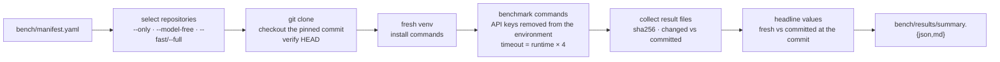

# Reproducible benchmarks

Every headline number on this site comes from a benchmark in one of the eleven repositories. This page is how to
check them without trusting me: a manifest pins each repository to a commit and says how to install it, how to run
its benchmark in a fast and a full mode, which result files it writes and which numbers to compare; a runner does
the rest in throwaway clones and fresh virtual environments.

## The manifest

[`bench/manifest.yaml`](https://github.com/iamsammy-ak/ai-architecture-teardown/blob/main/bench/manifest.yaml) holds,
per repository: the pinned commit, install commands, the benchmark commands of each mode, the expected runtime, the
result files, whether the mode downloads model weights or datasets, whether the benchmark is deterministic, and the
headline values to compare (as JSON pointers into the result files).

--8<-- "bench/results/manifest.md"

*Fast* mode uses smaller settings where a benchmark has them (fewer seeds, cases or users), so its numbers are a
smoke test of the pipeline, not a reproduction. *Full* mode uses the settings behind the committed results. For
trajectory-eval-gate the two are the same, because its full benchmark already runs in about a minute.

## The runner



```bash
PYTHONPATH=src python -m teardown manifest                          # validate and list the manifest
PYTHONPATH=src python -m teardown bench --dry-run --model-free      # print every command without running it
PYTHONPATH=src python -m teardown bench --only durable-agent-state-machine --fast
PYTHONPATH=src python -m teardown bench --model-free --fast         # what the reproduce workflow runs
PYTHONPATH=src python -m teardown bench --only typed-multi-agent-swarm --full
```

Design choices, briefly:

- **Clone at the commit, verify `HEAD`.** A benchmark of a newer commit is a different benchmark. The runner refuses
  to continue if the checkout is not exactly the pinned SHA.
- **A fresh virtual environment per repository.** Installing into a shared environment would let one repository's
  dependencies satisfy another's undeclared import. `--no-venv` exists for quick local iteration and is never used
  for the published summary.
- **No keys in the environment.** `OPENROUTER_API_KEY`, `OPENAI_API_KEY` and similar variables are removed before
  installing or running anything, so a benchmark cannot silently switch to a paid model.
- **Compare with the committed results at the same commit.** After the run, each headline value is read from the
  fresh result file and from `git show <commit>:<file>`; the summary shows both and the difference, and says whether
  the two are expected to agree (deterministic benchmark, same settings).
- **Records without machine paths.** Step records keep the manifest's spelling of each command, so a published
  summary carries no local paths.

## Latest local run

--8<-- "bench/results/summary.md"

Each run above cloned the repository from GitHub at its pinned commit, created a virtual environment, installed the
package and its dependencies from PyPI and ran the benchmark; most of the wall time is installation. The
trajectory-eval-gate run reproduces the committed headline numbers exactly, because its fast and full modes are the
same deterministic benchmark. The durable runtime's fast run (12 runs, 6 kills) is a smoke test: even the
direct-call baseline happened to publish nothing twice at that scale, against 10 duplicates in the committed
200-kill run.

## Smoke run of the other model-free fast modes

The remaining seven model-free fast modes were exercised once with
`--no-venv --clone-from <local mirrors>`: fresh clones at the pinned commits, but the shared development
interpreter instead of a fresh virtual environment, so this checks the commands and result files, not the
dependency declarations (the reproduce workflow does that in CI).

--8<-- "bench/results/smoke/summary.md"

Agentic RAG's hashing benchmark and the proxy's PII suite are the exact commands behind committed result files, and
they reproduced their committed headline values; the other fast modes use smaller settings and differ, as expected.

## In CI

[`.github/workflows/reproduce.yml`](https://github.com/iamsammy-ak/ai-architecture-teardown/blob/main/.github/workflows/reproduce.yml)
runs `python -m teardown bench --model-free --fast` on demand (`workflow_dispatch` only, so it never blocks a push)
and uploads the summary and collected result files as an artefact. Repositories whose fast mode needs model weights
or datasets (GraphRAG needs the spaCy pipeline; hybrid rerank needs the BEIR download) are excluded from that job and
documented here instead; their full modes need models, data or both and take 5-60 minutes each on a laptop CPU.

## What reproduction does and does not show

- It shows that each benchmark **runs from a clean checkout of the pinned commit** with only its declared
  dependencies, and that deterministic benchmarks give the committed numbers.
- It does **not** make synthetic data realistic or turn simulated agents into models. Reproducing a number proves it
  was computed as described, not that it predicts production behaviour; see the [lessons](lessons.md).
- Timing numbers in the committed results come from one busy laptop and are never used as headline checks.
