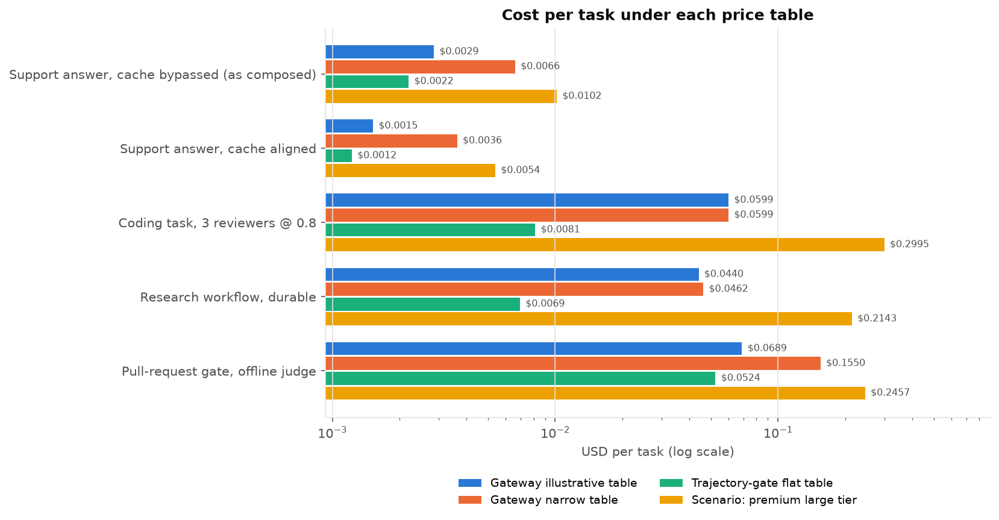
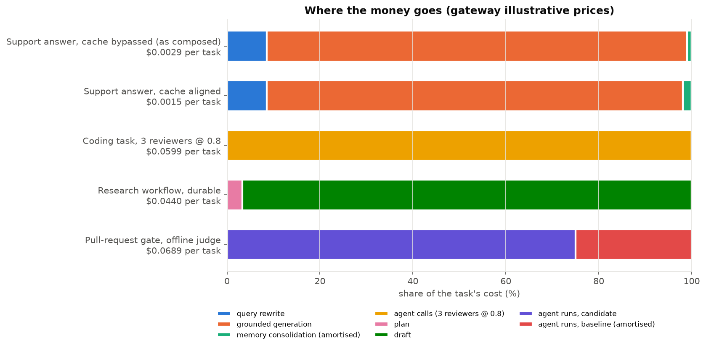
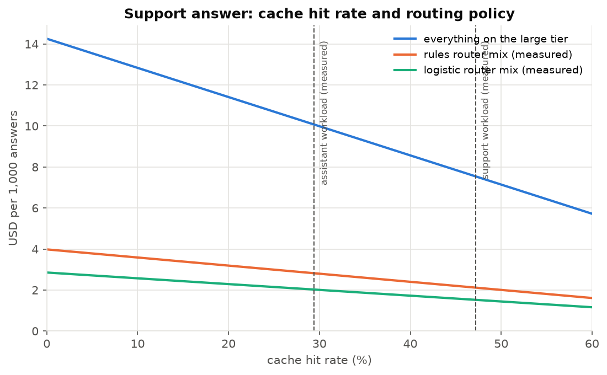
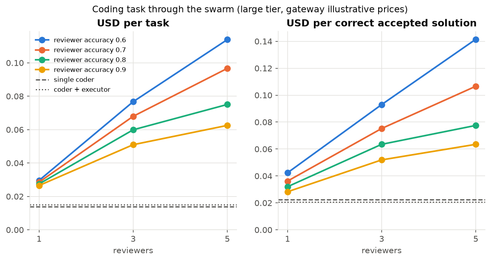
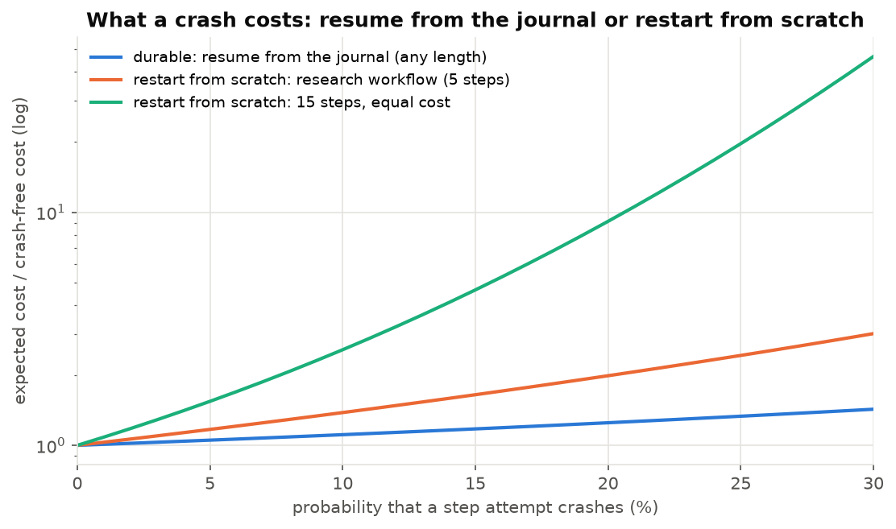

# Cost per task

What does one task cost on the composed platform, which knobs move that cost, and by how much? This page answers
with a small Python model ([`src/teardown/cost.py`](https://github.com/iamsammy-ak/ai-architecture-teardown/blob/main/src/teardown/cost.py))
whose every input is either **measured** (read from a results or data file of one of the repositories at its pinned
commit) or a **stated assumption** with its reason. Every table and chart below is generated by one command and
committed:

```bash
PYTHONPATH=src python -m teardown cost              # tables and charts
PYTHONPATH=src python -m teardown verify-sources    # re-read every measured input
```

!!! warning "Read the prices as illustrative"
    No price on this page is a quote. Three tables come from the repositories (each defines its prices as
    illustrative); the fourth is a hypothetical stress scenario defined here. Token counts for model calls are
    measured where a repository measures them and assumed otherwise; no repository has measured a live model yet.
    The value of the model is in the *ratios* and *sensitivities*, not the absolute cents.

## How the model works

A task is a list of LLM calls. Each call has an expected count per task, a size in input and output tokens, a tier
(`small`, `medium`, `large`, or `routed`, meaning the gateway's router picks one) and a flag saying whether the gateway
cache may serve it:

```text
USD per task = Σ over calls:  count
                             × (1 − h)  if the call is cacheable, else × 1
                             × (in × p_in(tier) + out × p_out(tier)) / 1,000,000
```

where `h` is the cache hit rate and `p_in`, `p_out` are USD per million tokens.

For a routed call the price is averaged over the routing mix; the measured mixes are the gateway's own routing of its
synthetic support workload (logistic router: 59.7% small, 27.5% medium, 12.8% large; rules router: 41.9 / 39.0 /
19.2). Non-LLM work (proxy screening, retrieval, assembly, durable steps) costs CPU, not tokens; its measured latency
is listed [below](#measured-latency-on-each-path).

| Task | Path through the platform | LLM calls and where their sizes come from |
|---|---|---|
| **Support answer** | gateway → proxy → memory → agentic RAG (hybrid / GraphRAG retrieval) → context assembler → model | Rewrite rounds: **measured** mean 0.42 per question. Generation: prompt of 3,072 tokens, the budget at which the assembler kept **every** planted fact (**measured**); answer of 250 tokens (assumed: half the generator's 500-token cap). Memory consolidation: 2 calls per session (assumed) over 7.6 answers per session (**measured** turns per session ÷ 2). |
| **Coding task** | proxy → typed swarm (researcher, coder, executor, N reviewers) → MCP tools | Agent calls and payload tokens per task: **measured** for every panel size and reviewer accuracy; success rate **measured** by executing the accepted code. System prompt of 800 tokens per call and a 35% output share: assumed. |
| **Research workflow** | durable runtime: plan → gather (GraphRAG, no LLM offline) → draft → human approval → publish | Plan: 1,200 in / 300 out (assumed). Draft: an 8,192-token prompt, the largest budget of the assembler's sweep, 1,200 out (assumed). Crash model: **measured** chaos run for scale, a closed-form expectation for the sweep. |
| **Pull-request gate** | trajectory gate in CI | Agent runs per pull request: 3 per case × 5 cases, plus a 20-run baseline per case amortised over 20 pull requests. Tokens per run: **measured** mean over the 100 baseline runs of the travel-desk agent (simulated usage). |

## Price tables

--8<-- "bench/results/cost/price_tables.md"

## Cost per task

--8<-- "bench/results/cost/headline.md"



What the table says:

- **The price table moves costs by up to 37x for the same tokens.** The coding task costs $0.0599 at the gateway's
  illustrative prices, $0.0081 under the trajectory gate's flat small-model price and $0.30 if the large tier is a
  reasoning-class model. Any cost claim without its price table is meaningless.
- **Routing is worth more than caching for the support answer**, and only under a wide price gap: under the narrow
  table the routed support answer costs *more* than under the illustrative one, because small and medium calls are
  10x and 2.5x pricier there while the large tier is unchanged.
- **The pull-request gate is the most expensive "task"** at the illustrative prices: 20 agent runs per pull request
  (15 candidate, 5 amortised baseline) at about 4,500 input tokens each. It is also the one whose cost buys the most
  certainty per dollar ([trade-offs](systems/trajectory-eval-gate.md#trade-offs)).

## Where the money goes



--8<-- "bench/results/cost/breakdown.md"

## Sensitivity

### Support answer: cache hit rate and routing



--8<-- "bench/results/cost/cache.md"

- **Routing dominates.** Moving from "everything on the large tier" to the measured logistic mix cuts the support
  answer by 80% before any cache hit; a 47% hit rate then halves what is left.
- **The cache only helps if the composition lets it.** As composed today the RAG generator's temperature (0.1) is
  above the gateway's cache cap (0.0), so the effective hit rate is zero: the left edge of the chart. Aligning the
  two is a one-line change worth about $1.33 per 1,000 answers here ([integration seams](architecture.md#integration-seams)).
- **The routing mix is borrowed.** It is the gateway's routing of *its* synthetic prompts; real RAG prompts carry
  3,000 tokens of evidence and may route differently. The logistic router also sends 13.7% of requests to a smaller
  tier than the author's label says they need, a quality risk this model does not price.

### Coding task: reviewers



--8<-- "bench/results/cost/reviewers.md"

- **Each extra correct solution from going 1 → 3 reviewers costs about $0.34-0.56** at large-tier illustrative
  prices, whatever the reviewer accuracy. Whether that is worth paying depends on what an accepted wrong solution
  costs downstream, which this model deliberately does not guess.
- **USD per correct solution alone favours the single coder** ($0.022), because it is cheap; it also accepts wrong
  code 38% of the time. Cost per correct outcome is the right unit only once a wrong outcome has a price.
- **Five noisy reviewers are worse than three on both axes** at accuracy 0.6: more calls and fewer correct outcomes
  (see [swarm topologies](swarm-topologies.md#reviewer-count-diminishing-returns-and-not-always-monotone)).

### Research workflow: what a crash costs



--8<-- "bench/results/cost/crashes.md"

Resuming from the journal costs `1 / (1 - p)` per step whatever the workflow's length; restarting from scratch
grows geometrically with the number of steps. For a five-step workflow the difference is modest (1.38x vs 1.11x at a
10% crash rate); for fifteen steps it is 2.6x vs 1.1x, and the direct-call baseline also published 10 articles twice.
Durability is cheap insurance: about 2 ms per step against a model call that takes seconds.

## Measured latency on each path

Medians from each component's own benchmark on a busy laptop CPU, non-LLM work only. They are indicative: the
components were never run in one process, and medians do not add up to a median.

--8<-- "bench/results/cost/latency.md"

## Inputs

### Measured inputs

Each value is re-read from its source at the pinned commit by `python -m teardown verify-sources`; CI checks that the
committed tables were generated from these inputs.

--8<-- "bench/results/cost/measurements.md"

### Assumptions

--8<-- "bench/results/cost/assumptions.md"

## What the model leaves out

- **Quality.** Under-routed answers, wrong cache hits (0.4% of semantic hits) and abstentions all have a cost that
  is not priced here.
- **Live token counts.** The swarm's tokens are estimates of its typed payloads (characters ÷ 4) plus an assumed
  system prompt; the travel-desk agent's token counts are simulated; the support and research prompt sizes are
  budgets, not measurements of real traffic.
- **Compute.** Embeddings, cross-encoders and sandboxes run on CPU here; at scale they need priced capacity too.
- **Provider prompt caching**, which would discount the stable prefix of repeated prompts.
