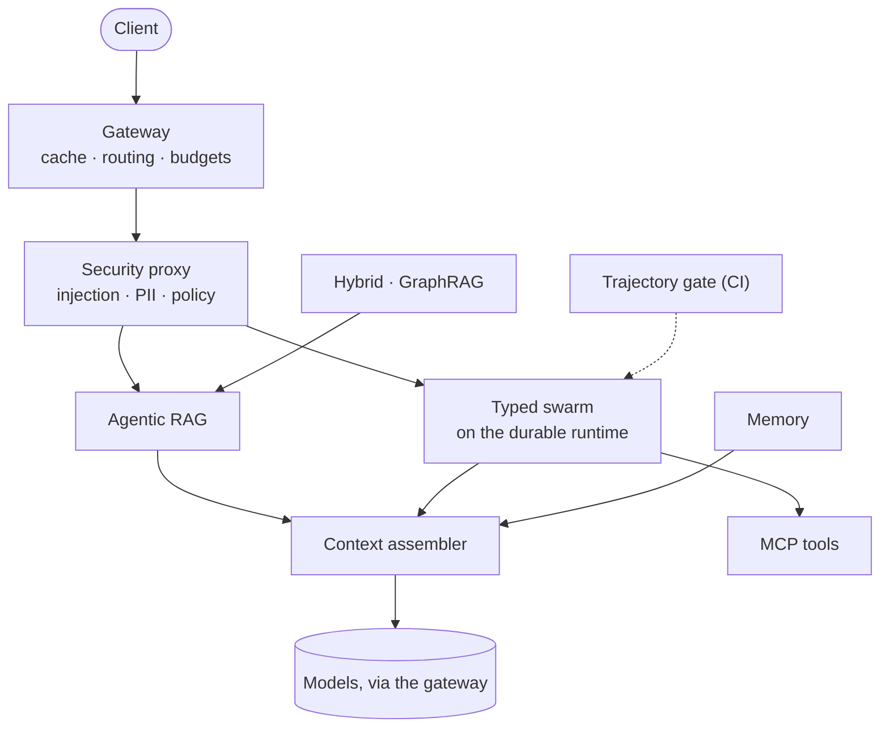

# AI Architecture Teardown

Eleven AI-engineering systems, each built as its own repository with its own tests and benchmark, taken apart and put
back together as one design: how they would compose into a production agent platform, why each was built the way it
was, what a task costs on it, and how to re-run every number yourself.

!!! info "What this is, and what it is not"
    It is a **design review of working code**: every claim links to the exact lines or results file at a pinned
    commit, and every benchmark can be re-run in a fresh clone with one command. It is **not** an integrated
    product: the eleven repositories do not import each other, and every number was measured with deterministic
    stand-ins for language models on mostly synthetic data. The [lessons](lessons.md) page is explicit about what that
    leaves open.



## Start here

<div class="grid cards" markdown>

-   **Reference architecture**

    ---

    The request path, trust boundaries, where state lives, every failure mode and where it is handled, and the honest
    list of seams that would need work to integrate.

    [Read the architecture](architecture.md)

-   **Eleven deep-dives**

    ---

    Problem, diagram, key mechanisms with code excerpts at the pinned commit, measured results, trade-offs, failure
    modes and what I would change at scale.

    [Browse the systems](systems/index.md)

-   **Cost per task**

    ---

    A Python model priced under four tables, with sensitivity to cache hit rate, routing mix, reviewer count and crash
    rate. Every input is measured or a stated assumption.

    [See the costs](cost.md)

-   **Decisions**

    ---

    Sixteen architecture decision records in MADR format, from explicit state machines to hash-chained audit logs.

    [Read the ADRs](adr/index.md)

</div>

## Headline numbers

All measured by the repositories' own benchmarks at their pinned commits; the data behind each is described on its
deep-dive page.

<div class="grid cards" markdown>

-   <span class="kpi">4.3% vs 27.5%</span>

    wrong answers, self-correcting agentic RAG vs naive RAG (synthetic handbook, no LLM)

-   <span class="kpi">0 vs 10</span>

    duplicate publications under 200 real worker kills, durable outbox vs direct calls

-   <span class="kpi">0.4% vs 29.5%</span>

    wrong semantic-cache hits with and without guard rails at the same threshold

-   <span class="kpi">100% vs 55.3%</span>

    seeded agent regressions blocked, trajectory gate vs outcome-only grading

-   <span class="kpi">97.9% vs 62.0%</span>

    accepted-solution correctness, three reviewers @ 0.8 vs a single coder (simulated competence)

-   <span class="kpi">0.224 vs 0.776</span>

    stale facts recalled, versioned memory vs a flat vector store

</div>

## Reproduce

```bash
git clone https://github.com/iamsammy-ak/ai-architecture-teardown.git
cd ai-architecture-teardown
python -m venv .venv && source .venv/bin/activate      # Windows: .venv\Scripts\activate
pip install -e ".[dev]"
python -m teardown cost                                  # the cost model, tables and charts
python -m teardown verify-sources                        # re-read every measured input at its pinned commit
python -m teardown bench --only trajectory-eval-gate     # clone, install and re-run one benchmark
mkdocs serve                                             # this site, locally
```

See [reproducible benchmarks](benchmarks.md) for the manifest and the runner.

## The systems

| | System | Repository |
|---|---|---|
| Edge | Semantic cache gateway | [semantic-cache-gateway](https://github.com/iamsammy-ak/semantic-cache-gateway) |
| Trust | Inter-agent security proxy | [inter-agent-security-proxy](https://github.com/iamsammy-ak/inter-agent-security-proxy) |
| Context | Context assembler engine | [context-assembler-engine](https://github.com/iamsammy-ak/context-assembler-engine) |
| Memory | Three-tier agent memory | [three-tier-agent-memory](https://github.com/iamsammy-ak/three-tier-agent-memory) |
| Retrieval | Hybrid rerank retrieval | [hybrid-rerank-retrieval](https://github.com/iamsammy-ak/hybrid-rerank-retrieval) |
| Retrieval | GraphRAG knowledge pipeline | [graphrag-knowledge-pipeline](https://github.com/iamsammy-ak/graphrag-knowledge-pipeline) |
| Answering | Self-correcting agentic RAG | [self-correcting-agentic-rag](https://github.com/iamsammy-ak/self-correcting-agentic-rag) |
| Orchestration | Typed multi-agent swarm | [typed-multi-agent-swarm](https://github.com/iamsammy-ak/typed-multi-agent-swarm) |
| Runtime | Durable agent state machine | [durable-agent-state-machine](https://github.com/iamsammy-ak/durable-agent-state-machine) |
| Tools | Raw MCP tool server | [raw-mcp-tool-server](https://github.com/iamsammy-ak/raw-mcp-tool-server) |
| Quality | Trajectory eval gate | [trajectory-eval-gate](https://github.com/iamsammy-ak/trajectory-eval-gate) |
