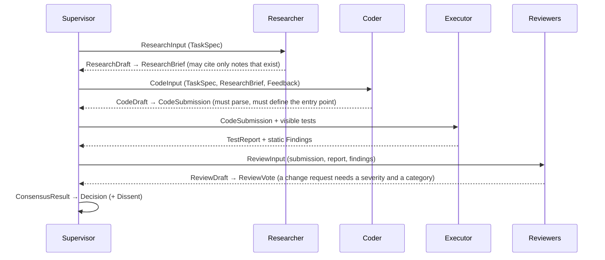
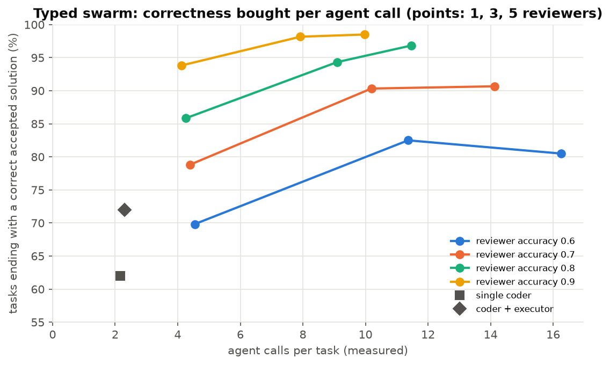

# Swarm topologies

How agents are wired together decides what a multi-agent system costs, how it fails and whether anyone can explain
what it did. The [typed swarm](systems/typed-multi-agent-swarm.md) implements one topology, a **supervisor with a
review panel**, and measures it against simpler ones. This page compares it with the other common shapes (peer
debate, hierarchical, pipeline, blackboard), shows the typed hand-off contract that holds the implemented one
together, and reports what the benchmark actually showed.

!!! note "What was measured and what was not"
    Only the supervisor topology and its ablations (single coder, coder + executor, 1/3/5 reviewers, debate on or off,
    three consensus rules, a veto, correlated errors) were benchmarked, offline, with simulated agent competence and
    real code execution. The other four topologies below are design comparisons, not measurements.

## The five shapes

=== "Supervisor (implemented)"

    ```mermaid
    flowchart TB
        S{"Supervisor<br/>explicit state machine<br/>budgets checked before each phase"}
        R["Researcher"]
        C["Coder"]
        E["Executor<br/>(not an LLM)"]
        V1["Reviewer 1"]
        V2["Reviewer 2"]
        V3["Reviewer 3"]
        K["Consensus<br/>+ security veto"]
        S <-->|"typed artifacts"| R
        S <-->|"typed artifacts"| C
        S <-->|"code + visible tests"| E
        S --> V1 & V2 & V3
        V1 & V2 & V3 --> K
        K -->|"decision + dissent"| S
    ```

    Hub and spoke: every hand-off goes through the supervisor, which owns routing, budgets and the decision.
    Workers never talk to each other directly, except reviewers reading each other's rationales during debate.

=== "Peer debate"

    ```mermaid
    flowchart LR
        A1["Agent A"] <--> A2["Agent B"]
        A2 <--> A3["Agent C"]
        A3 <--> A1
        A1 & A2 & A3 --> J["Judge or vote<br/>after k rounds"]
    ```

    Every agent sees every other agent's argument each round. Simple to build; cost grows with agents × rounds
    × the length of the transcript, and the outcome can go to whoever sounds most confident.

=== "Hierarchical"

    ```mermaid
    flowchart TB
        M["Manager"]
        L1["Lead: research"]
        L2["Lead: build"]
        M --> L1 & L2
        L1 --> W1["Worker"] & W2["Worker"]
        L2 --> W3["Worker"] & W4["Worker"]
    ```

    Supervisors of supervisors. Scales to large task trees; every level adds latency, a place for context to be
    lost in summarisation and, if the managers are LLMs, a non-deterministic routing decision.

=== "Pipeline"

    ```mermaid
    flowchart LR
        P1["Plan"] --> P2["Research"] --> P3["Draft"] --> P4["Review"] --> P5["Publish"]
    ```

    A fixed sequence of stages. Cheapest and most predictable; no loop-back unless one is designed in. The
    [durable runtime's research workflow](systems/durable-agent-state-machine.md) is a pipeline with a human gate.

=== "Blackboard"

    ```mermaid
    flowchart TB
        B[("Blackboard<br/>shared typed state")]
        X1["Agent: extractor"] <--> B
        X2["Agent: critic"] <--> B
        X3["Agent: planner"] <--> B
        CTL["Controller<br/>picks who acts next"] --> B
    ```

    Agents read and write a shared store and react to what changed. Flexible for open-ended problems; hard to
    budget and to audit unless the controller and the state schema are explicit.

## Comparison

| | Supervisor | Peer debate | Hierarchical | Pipeline | Blackboard |
|---|---|---|---|---|---|
| Who decides what happens next | One explicit state machine | Nobody until the judge | Each manager | The fixed order | A controller over shared state |
| Calls per task | Grows with reviewers (measured: 4.3 → 9.1 → 11.5 for 1/3/5 reviewers at 0.8) | agents × rounds | Sum over the tree | Number of stages | Unbounded unless capped |
| Budget enforcement | Before each phase (property-tested) | Per round | Per level, if at all | Trivial | Needs a controller |
| Auditability | Every transition logged with its reason | Transcript | Nested logs | Linear log | Depends on the store's history |
| Main failure mode | The supervisor's rules are too rigid for open-ended work | Herding, confident wrong answers | Lost context between levels | No recovery from a bad early stage | Thrashing, unclear ownership |
| Where it fits | Tasks with a checkable outcome (code, data, forms) | Small panels on split decisions only | Large, decomposable projects | Repeatable workflows | Exploratory analysis |
| Measured here | **Yes** | As a bounded step inside the supervisor | No | As the durable runtime's workflow | No |

The implemented design borrows from two of the others deliberately: **debate** is used only on split votes and only
for one round, with evidence the Executor can check; and a **pipeline** is what the durable runtime runs, so a swarm
on the runtime would be a pipeline of supervisor phases.

## The typed hand-off contract

Every message between roles is a frozen Pydantic artifact that rejects unknown fields
([`artifacts.py` L135-L138](https://github.com/iamsammy-ak/typed-multi-agent-swarm/blob/37b44ec34961f5d3879863a284f203e79d06c1c3/src/agent_swarm/artifacts.py#L135-L138)):

```python
class Artifact(BaseModel):
    """Base class: immutable, and unknown fields are rejected rather than silently dropped."""

    model_config = ConfigDict(frozen=True, extra="forbid")
```



The validators carry semantics, not just types. A coder's draft must parse and define the task's entry point
([`artifacts.py` L255-L270](https://github.com/iamsammy-ak/typed-multi-agent-swarm/blob/37b44ec34961f5d3879863a284f203e79d06c1c3/src/agent_swarm/artifacts.py#L255-L270)),
and a reviewer's vote must be internally coherent
([`artifacts.py` L351-L372](https://github.com/iamsammy-ak/typed-multi-agent-swarm/blob/37b44ec34961f5d3879863a284f203e79d06c1c3/src/agent_swarm/artifacts.py#L351-L372)):

```python
class ReviewDraft(Artifact):
    """What a reviewer agent returns."""

    verdict: Verdict
    severity: Severity = Severity.NONE
    category: Category = Category.NONE
    confidence: float = Field(ge=0.0, le=1.0)
    rationale: str = Field(min_length=10, max_length=1_500)
    evidence: list[str] = Field(default_factory=list, max_length=10)
    counterexample: ProposedTest | None = None

    @model_validator(mode="after")
    def _coherent(self) -> ReviewDraft:
        if self.verdict is Verdict.APPROVE and self.severity.rank > Severity.MINOR.rank:
            raise ValueError("an approval cannot carry a major or critical severity")
        if self.verdict is Verdict.REQUEST_CHANGES:
            if self.severity is Severity.NONE:
                raise ValueError("a change request needs a severity of minor, major or critical")
            if self.category is Category.NONE:
                raise ValueError("a change request needs a category")
        return self
```

When a reply fails validation, the hand-off layer sends a structured `RepairRequest` (schema name, attempt,
field-level errors, the previous output) at most `max_repairs` times, and each attempt is charged to the budget
([`handoff.py` L86-L130](https://github.com/iamsammy-ak/typed-multi-agent-swarm/blob/37b44ec34961f5d3879863a284f203e79d06c1c3/src/agent_swarm/handoff.py#L86-L130)).
Agents return text, not objects, so the simulated agents and LLM agents go through exactly the same parsing and repair
path ([ADR-0013](adr/0013-typed-handoffs-bounded-repair.md)).

## What the benchmark showed

Source: [`swarm_benchmark.md`](https://github.com/iamsammy-ak/typed-multi-agent-swarm/blob/37b44ec34961f5d3879863a284f203e79d06c1c3/benchmarks/results/swarm_benchmark.md)
at `37b44ec`: 20 tasks × 30 seeds, 600 episodes per configuration; coder skill 0.5, 5% malformed replies; correctness
measured by running the accepted code against hidden tests.



### Reviewer count: diminishing returns, and not always monotone

| Reviewers | @ 0.6 correct overall | @ 0.7 | @ 0.8 | @ 0.9 | Calls / task @ 0.8 |
|---:|---:|---:|---:|---:|---:|
| 1 | 69.8% | 78.8% | 85.8% | 93.8% | 4.3 |
| 3 | 82.5% | 90.3% | 94.3% | 98.2% | 9.1 |
| 5 | 80.5% | 90.7% | 96.8% | 98.5% | 11.5 |

Going from one to three reviewers is worth 8-13 points of correct outcomes; going from three to five is worth 0-3
points, and at accuracy 0.6 it *loses* two, because a larger noisy panel accepts less (86.5% vs 90.3%) even though
what it accepts is more often right (93.1% vs 91.3%). Single coder: 62.0% at 2.2 calls; coder + executor: 72.0% at
2.3 calls. Running the visible tests is the cheapest ten points in the table.

### Debate: helps small panels, mostly trades for caution in large ones

Paired comparison (same seeds, identical independent votes; reviewer accuracy 0.7):

| Panel | Split first votes | Decision accuracy without debate | With debate | Fixed | Broken |
|---|---:|---:|---:|---:|---:|
| 3 reviewers | 364 | 64.8% | 78.0% | 72 | 24 |
| 5 reviewers | 265 | 69.4% | 71.7% | 42 | 36 |

Debate raised accepted-solution correctness from 89.8% to 96.1% (three reviewers) at about three extra calls per
task. For five reviewers it broke almost as many split decisions as it fixed: herding (20% conformity in the
simulation) and bogus counterexamples (30% of false alarms cite a wrong expected value) cut both ways. Grounding the
debate in execution is what makes it net positive for small panels; it does not make it free.

### Correlated errors: voting only helps as far as reviewers differ

| 3 reviewers @ 0.7 | Accepted-solution correctness | Insecure accepted |
|---|---:|---:|
| Independent errors | 96.1% | 0 |
| Correlation 0.5 | 94.7% | 1 |
| Correlation 0.9 | 91.1% | 5 |

At 0.9 correlation three reviewers behave much like one. In LLM mode the swarm gives each reviewer a different
first-choice model to decorrelate their mistakes; whether real models are decorrelated enough is not measured.

### Consensus rules and the veto

| Mixed panel (accuracies 0.9 / 0.65 / 0.6) | Correct overall | Calls / task |
|---|---:|---:|
| Majority | 91.8% | 10.1 |
| Reliability-weighted (log-odds of calibrated accuracy) | **94.8%** | **7.7** |
| Quorum 3 of 3 | 79.3% | 12.1 |

Weighting helps when reliabilities differ and is cheaper, because decisive votes avoid debate rounds. Unanimity is
the most precise (98.6% of accepted solutions correct) and the least useful (80.5% accepted). Separately, a security
veto cut insecure approvals from 19 of 93 reviews (20.4%) to 5 of 93 (5.4%) on the three tasks with
security-defective candidates.

## Design guidance from the numbers

1. **Put a non-LLM verifier in the loop first.** Executing the visible tests buys ten points for 0.1 extra calls.
2. **Three decorrelated reviewers before five correlated ones.** Correlation erodes the benefit faster than adding
   reviewers restores it.
3. **Weight by measured reliability** when reviewers differ; it raised correctness and lowered cost here.
4. **Debate only on split votes, bounded, with checkable evidence.** It is a tool for small panels.
5. **Give security a veto** rather than another vote; the cost of accepting insecure code is asymmetric.
6. **Price it per correct outcome.** The [cost model](cost.md#coding-task-reviewers) does this per reviewer count.
