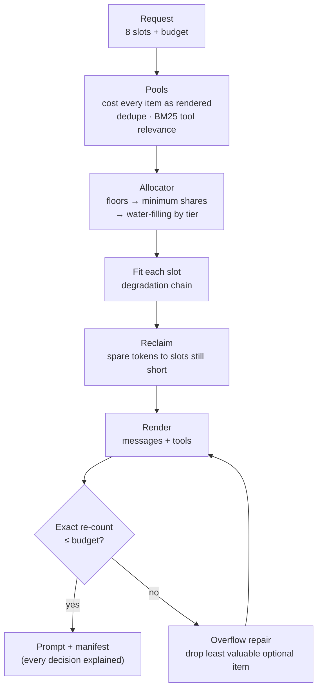

# Context Assembler Engine

!!! abstract "At a glance"
    **Repository:** [iamsammy-ak/context-assembler-engine](https://github.com/iamsammy-ak/context-assembler-engine) ·
    pinned at [`1f7863c`](https://github.com/iamsammy-ak/context-assembler-engine/tree/1f7863ceab66f865fa5e69ff1d0806df8ed260fb)
    · **Platform role:** the last step before every model call: it decides what fits in the context window.

    **Measured (synthetic support conversations):** 88.6% retention of planted facts across eight budgets with zero
    budget violations in 320 assemblies, against 66.2% for a fixed proportional split; 100% retention from a
    3,072-token budget upwards.

## Problem

A context window is shared by the system prompt, tool schemas, memories, retrieved documents, conversation history,
examples and the question. The usual ways of staying under the limit are blunt: cutting at the limit removes
whatever comes last (often the question), keeping recent turns forgets facts given twenty messages ago, fixed
percentages waste space when one source is small, and counting raw text ignores the tokens the chat format adds, so
a prompt that "fits" can still be rejected.

## Architecture



## Key mechanisms

**Verify the rendered prompt, then repair deterministically.** Byte-pair encodings are not additive, so per-item
counts are estimates. The engine renders the final prompt, re-counts it with the tokenizer (cache bypassed) and, if
it is over, removes the least valuable optional item of the lowest-priority slot until it fits
([`assembler.py` L187-L206](https://github.com/iamsammy-ak/context-assembler-engine/blob/1f7863ceab66f865fa5e69ff1d0806df8ed260fb/src/context_assembler/assembler.py#L187-L206)):

```python
def _render_verified(self, pools, fits, budget, fixed):
    """Render, count exactly, and remove items deterministically while the prompt is over budget."""
    repairs = 0
    while True:
        messages, tools = render_prompt({slot: fit.kept for slot, fit in fits.items()})
        verified = count_prompt(self.tokenizer, messages, tools, self.chat_format, use_cache=False)
        if verified <= budget:
            return messages, tools, verified, repairs
        victim = self._overflow_victim(pools, fits)
        if victim is None:
            breakdown = {"format overhead": fixed} | {s.value: pools[s].floor for s in SLOT_ORDER}
            raise BudgetExceededError(verified, budget, breakdown)
        slot, candidate = victim
        drop_candidate(fits[slot], candidate, f"overflow repair: ... {verified - budget} token(s) over")
        ...
```

**Water-filling within strict priority tiers.** Required floors first, then minimum shares tier by tier, then each
tier is filled by weight up to its cap; caps relax only if tokens would otherwise go unused
([`allocator.py` L80-L100](https://github.com/iamsammy-ak/context-assembler-engine/blob/1f7863ceab66f865fa5e69ff1d0806df8ed260fb/src/context_assembler/allocator.py#L80-L100)):

```python
def allocate(demands, budget, *, strict_max_share=False) -> dict[SlotKind, int]:
    """Token grant per slot. Guarantees ``floor <= grant <= demand`` and ``sum(grants) <= budget``."""
    grants = {d.slot: d.floor for d in demands}
    remaining = budget - sum(grants.values())
    if remaining < 0:
        raise InsufficientBudgetError(...)
    ...
    for tier in tiers:  # 2. minimum shares
        caps = {d.slot: min(d.demand, max(d.floor, math.ceil(d.min_share * budget))) for d in by_tier[tier]}
        remaining = _water_fill(grants, by_tier[tier], caps, remaining)
    for tier in tiers:  # 3. priority water-filling under max_share caps
        caps = {d.slot: max(grants[d.slot], min(d.demand, math.floor(d.max_share * budget))) for d in by_tier[tier]}
        remaining = _water_fill(grants, by_tier[tier], caps, remaining)
    if not strict_max_share:  # 4. spill-over: relax caps rather than leave tokens unused
        ...
```

**Degradation chains, not drop-only.** History: summarise the oldest turns, then drop them (pinned turns stay).
Retrieved chunks: deduplicate, greedy knapsack by score² per token, trim the last one at a sentence boundary, then
order strongest-at-the-edges against lost-in-the-middle. Tools: top-k by BM25 relevance, strip descriptions, drop.
Every step is named and recorded in the manifest.

## Measured results

Source: [`benchmark.md`](https://github.com/iamsammy-ak/context-assembler-engine/blob/1f7863ceab66f865fa5e69ff1d0806df8ed260fb/benchmarks/results/benchmark.md)
(40 seeded synthetic conversations of 4,746-5,492 tokens, six planted facts each, eight budgets from 512 to 8,192
tokens, `o200k_base`).

| Strategy | Fact retention | Query kept | Budget violations | Mean wasted tokens |
|---|---:|---:|---:|---:|
| Head truncation | 61.1% | 25.0% | 209 / 320 | 3 |
| Keep most recent | 75.6% | 100% | 227 / 320 | 1 |
| Fixed proportional split | 66.2% | 100% | 0 / 320 | 902 |
| **Context Assembler Engine** | **88.6%** | **100%** | **0 / 320** | **8** |

| Prompt budget | 512 | 1,024 | 2,048 | 3,072 | 4,096 | 8,192 |
|---|---:|---:|---:|---:|---:|---:|
| Engine fact retention | 45.0% | 81.2% | 95.4% | 100% | 100% | 100% |

The 3,072-token point is used by the [cost model](../cost.md) as the prompt size of a support answer.

## Trade-offs

- **More work per assembly**: deduplication, BM25 and a final exact re-count make it slower than naive strategies
  (37.6 ms vs about 10 ms median on a busy laptop). Next to a model call that takes seconds, it is noise.
- **Greedy knapsack instead of exact dynamic programming**: easier to explain item by item and at least half the
  optimum with the best-single-item check; squaring the score stops several weak chunks beating one strong one.
- **Extractive summaries by default** keep assembly deterministic and free; the LLM summariser is optional and is
  still hard-capped by the tokenizer.
- **Shingles and Jaccard for near-duplicates** need no model, but miss paraphrases.

## Failure modes

| Failure | What happens | Where it is handled |
|---|---|---|
| Estimates off because BPE merges across boundaries | Prompt a few tokens over | Exact re-count and repair loop (property-tested with an adversarial tokenizer) |
| Required items alone exceed the budget | Cannot fit | `BudgetExceededError` raised only after rendering the required-only prompt |
| Provider counts tools differently from the recipe | Off-by-some tokens | Configurable safety margin |
| Fact in a middle-ranked chunk at a tiny budget | Dropped (63% survival at 512 tokens) | By policy: lower-ranked chunks go first |
| Model family tiktoken does not cover | Wrong counts | Plug in a `Tokenizer`; the guarantee holds for the tokenizer supplied |

## What I would change at scale

1. **Prompt-caching-aware layout**: keep a stable prefix (system, tools, pinned memory) across turns so provider-side
   prompt caches hit; today the engine optimises one prompt at a time.
2. **Tool-call and tool-result messages in the history slot**, which agent loops produce in volume.
3. **Embedding-based relevance and paraphrase-aware deduplication** as an option, with the lexical path kept for CI.
4. **Tokenizer adapters** for other model families, so the "never over budget" guarantee travels with the router's
   choice of model.
