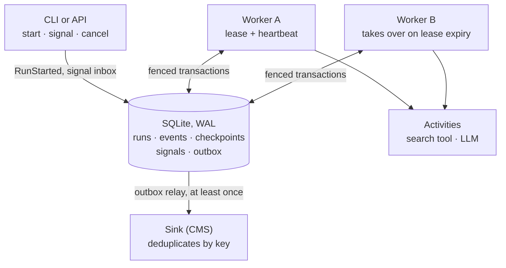

# Durable Agent State Machine

!!! abstract "At a glance"
    **Repository:** [iamsammy-ak/durable-agent-state-machine](https://github.com/iamsammy-ak/durable-agent-state-machine) ·
    pinned at [`5facc0f`](https://github.com/iamsammy-ak/durable-agent-state-machine/tree/5facc0f0b769a2e68a57b8601f0730d9f8d4382f)
    · **Platform role:** the runtime under every long-running workflow: survives crashes, retries flaky tools, waits
    for people, publishes once.

    **Measured (chaos benchmark, 200 real process kills):** 756 of 756 runs ended as their decision implied, no
    journal invariant broken, no completed step executed again and **0 duplicate publications**, against **10** when
    the same workflow called the side effect directly. A durable step costs about 2 ms.

## Problem

An agent that researches, drafts and publishes is a long-running process with three kinds of failure that a `for`
loop around an LLM call does not survive: crashes (a deploy or an out-of-memory kill loses everything in memory, and
a rerun repeats both model calls and side effects), flaky dependencies (search APIs time out and rate-limit), and
people (an approval can take days, and nothing should sit in memory waiting for it).

## Architecture



The example research workflow: `plan` (LLM) → `gather` (flaky search) → `draft` (LLM) → `approval` (human gate:
approve, edit or reject; timeout escalates, then auto-rejects) → `publish` (through the outbox) → `done`.

## Key mechanisms

**An append-only journal enforced by the database.** SQL triggers reject any `UPDATE` or `DELETE` of an event
([`store.py` L60-L63](https://github.com/iamsammy-ak/durable-agent-state-machine/blob/5facc0f0b769a2e68a57b8601f0730d9f8d4382f/src/durable_agent/store.py#L60-L63)):

```sql
CREATE TRIGGER IF NOT EXISTS events_no_update BEFORE UPDATE ON events
    BEGIN SELECT RAISE(ABORT, 'the event journal is append-only'); END;
CREATE TRIGGER IF NOT EXISTS events_no_delete BEFORE DELETE ON events
    BEGIN SELECT RAISE(ABORT, 'the event journal is append-only'); END;
```

**Fenced transactions.** Every write checks, inside its transaction, that the run still carries this worker's lease
owner and epoch and that the journal is where the worker thinks it is. A worker that froze past its lease gets
`LeaseLost` instead of writing
([`store.py` L326-L357](https://github.com/iamsammy-ak/durable-agent-state-machine/blob/5facc0f0b769a2e68a57b8601f0730d9f8d4382f/src/durable_agent/store.py#L326-L357)):

```python
row = conn.execute(
    "SELECT lease_owner, lease_epoch, last_seq FROM runs WHERE run_id = ?", (state.run_id,)
).fetchone()
if row is None:
    raise RunNotFound(state.run_id)
if lease is not None and (row["lease_owner"] != lease.owner or row["lease_epoch"] != lease.epoch):
    raise LeaseLost(
        f"run {state.run_id}: lease epoch {lease.epoch} of {lease.owner} is stale "
        f"(now held by {row['lease_owner']} at epoch {row['lease_epoch']})"
    )
if row["last_seq"] != state.last_seq:
    raise LeaseLost(f"run {state.run_id}: journal is at seq {row['last_seq']}, not {state.last_seq}")
```

**A transactional outbox with idempotency keys.** A step never performs a side effect directly; it queues a message
that commits in the same transaction as the step result, and the relay delivers it at least once under a key that is
identical for every attempt and every worker
([`outbox.py` L1-L7](https://github.com/iamsammy-ak/durable-agent-state-machine/blob/5facc0f0b769a2e68a57b8601f0730d9f8d4382f/src/durable_agent/outbox.py#L1-L7),
[`context.py` L54-L56](https://github.com/iamsammy-ak/durable-agent-state-machine/blob/5facc0f0b769a2e68a57b8601f0730d9f8d4382f/src/durable_agent/context.py#L54-L56)):

```python
def idempotency_key(self) -> str:
    """``"<run>/<state>#<visit>"``: identical for every attempt and every worker that runs this step."""
    return f"{self.run_id}/{self.step}"
```

**Recorded decisions, not replayed code.** `StepCompleted` carries the chosen next state, so recovery is a fold over
data from the latest checkpoint: guards are never re-evaluated and workflow code has no determinism rules.

## Measured results

Sources: [`chaos.md`](https://github.com/iamsammy-ak/durable-agent-state-machine/blob/5facc0f0b769a2e68a57b8601f0730d9f8d4382f/benchmarks/results/chaos.md),
[`overhead.md`](https://github.com/iamsammy-ak/durable-agent-state-machine/blob/5facc0f0b769a2e68a57b8601f0730d9f8d4382f/benchmarks/results/overhead.md)
(8 worker subprocesses with seeded kill plans, search fails 30% of attempts, stand-in LLM, busy laptop).

| Chaos metric | Outbox (as designed) | Direct call (baseline) |
|---|---:|---:|
| Runs | 756 | 926 |
| Worker processes killed | 200 | 196 |
| Runs ending as their decision implies | **756 / 756** | 926 / 926 |
| **Runs published twice** | **0** | **10** |
| Redeliveries absorbed by the idempotency key | 19 | n/a |
| Journal invariant violations · completed steps executed again | 0 · 0 | 0 · 0 |
| Interrupted attempts re-run (`WorkerLost`) | 89 | 94 |
| Recovery time p50 / p95 (lease TTL 1 s) | 1.01 / 1.18 s | 0.99 / 1.03 s |

| Persistence overhead | ms per step, median |
|---|---:|
| `synchronous=NORMAL`, checkpoint every transition | 1.97 |
| `synchronous=FULL`, checkpoint every transition | 3.32 |
| In memory, no persistence | 0.03 |

Rebuilding a run from a checkpoint stays at about 1 ms whether the journal holds 296 or 6,186 events; a full replay
of 6,186 events takes 263 ms.

## Trade-offs

- **Expressiveness for inspectability**: loops and branches are transitions, not Python control flow, so the
  definition can be validated and drawn, and replay needs no determinism discipline.
- **One SQLite file**: one local transaction covers journal, checkpoints, signals and outbox, which is what makes the
  outbox atomic without two-phase commit; the cost is that all workers share one host's disk.
- **Recovery latency is the lease TTL**: a shorter TTL recovers faster but risks taking over from a worker that is
  only slow.
- **Effectively once, not exactly once**: the sink must deduplicate, and delivery is asynchronous to the step.

## Failure modes

| Failure | What happens | Where it is handled |
|---|---|---|
| Worker killed mid-step | Interrupted attempt | Lease expires, another worker records `RunRecovered` and re-runs only that attempt |
| Worker freezes past its lease, then wakes | Would double-write | Fencing: its next write raises `LeaseLost` |
| Crash between delivering a side effect and marking it delivered | Redelivery | Same idempotency key; the sink drops it (19 absorbed in the chaos run) |
| Activity crashes its worker every time (poison input) | Infinite loop | A lost worker uses up an attempt; `max_attempts` ends it |
| Approval never arrives | Run waits forever | Durable timer: escalate, then auto-reject |
| Power cut | Last commits may be lost (never corruption) | `synchronous=FULL` closes it for about 1.4 ms more per step |
| Workers on several machines | SQLite locks are not reliable over network file systems | Not handled: single host by design |

## What I would change at scale

1. **A Postgres store** with `SELECT ... FOR UPDATE SKIP LOCKED` for workers on several machines; the fencing and
   outbox logic carry over unchanged because they are already transactional.
2. **Parallel branches and child workflows** (fan-out and join), which agent swarms need.
3. **Versioned workflow definitions** with migrations for in-flight runs.
4. **Push instead of poll** for ready runs, so timers fire on time without a polling interval.
