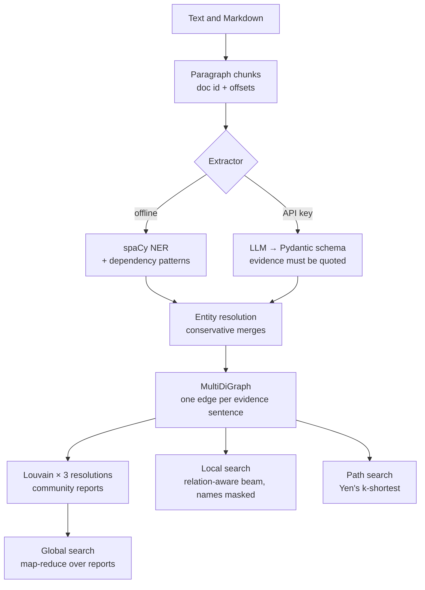

# GraphRAG Knowledge Pipeline

!!! abstract "At a glance"
    **Repository:** [iamsammy-ak/graphrag-knowledge-pipeline](https://github.com/iamsammy-ak/graphrag-knowledge-pipeline) ·
    pinned at [`21dc6d1`](https://github.com/iamsammy-ak/graphrag-knowledge-pipeline/tree/21dc6d17dbd5fbc6ef827b8963c6a746f644b96e)
    · **Platform role:** multi-hop retrieval: questions whose answer is two or three facts away from the entity they
    name.

    **Measured (synthetic corpus, 32 held-out test questions):** graph local search retrieves every supporting chunk
    within the top 5 for 75% of questions, against 19% for vector search; the offline extractor's honest held-out
    relation F1 is 0.58.

## Problem

Vector search finds passages that look like the question. In "In which province is the company that makes the
Halcyon Sensor headquartered?" the sentence with the answer never mentions the sensor or its maker: you have to read
one fact, follow it to the next entity and read again. A knowledge graph makes those links explicit, so retrieval can
walk from the question's entity to the evidence and show its working.

## Architecture



## Key mechanisms

**Score each edge by its relation wording, with entity names masked on both sides.** "X is a robotics company
headquartered in X" is compared with the masked question, so the walk follows "makes" then "headquartered" instead
of shared names
([`search/local.py` L89-L109](https://github.com/iamsammy-ak/graphrag-knowledge-pipeline/blob/21dc6d17dbd5fbc6ef827b8963c6a746f644b96e/src/graphrag_pipeline/search/local.py#L89-L109)):

```python
def prepare(self, text: str, extra_names: Sequence[str] = ()) -> str:
    """Replace entity names with a placeholder (when masking is on)."""
    if not self.mask_entities:
        return text
    for name in sorted(extra_names, key=len, reverse=True):
        text = re.sub(rf"(?<![\w-]){re.escape(name)}(?![\w-])", MASK, text, flags=re.I)
    return self._names.sub(MASK, text) if self._names is not None else text
```

**A beam search over relation paths** multiplies edge relevances hop by hop, keeps the best path per end entity and
credits every chunk with the best path through its evidence; co-occurrence edges are discounted
([`search/local.py` L160-L190](https://github.com/iamsammy-ak/graphrag-knowledge-pipeline/blob/21dc6d17dbd5fbc6ef827b8963c6a746f644b96e/src/graphrag_pipeline/search/local.py#L160-L190)):

```python
for _ in range(cfg.max_hops):
    expanded: list[Path] = []
    for nodes, edge_ids, score in frontier:
        for other, index in self._incident.get(nodes[-1], []):
            if other in nodes:
                continue
            edge = self._edges[index]
            strength = cfg.relevance_floor + relevance.get(edge.evidence, 0.0)
            if edge.type == COOCCURRENCE:
                strength *= cfg.cooccurrence_factor
            path: Path = (nodes + (other,), edge_ids + (index,), score * strength)
            ...
    frontier = list(per_end.values())[: cfg.beam_width]
```

**Conservative entity resolution.** A wrong merge creates a false bridge that multi-hop search will happily walk; a
missed merge only loses a link. Short forms merge only into a unique compatible long form, and places never merge
into organisations
([`resolution.py` L179-L203](https://github.com/iamsammy-ak/graphrag-knowledge-pipeline/blob/21dc6d17dbd5fbc6ef827b8963c6a746f644b96e/src/graphrag_pipeline/resolution.py#L179-L203)):

```python
def _compatible(short_type: str, long_type: str) -> bool:
    """Place names never merge with non-place names ("Quorvale" vs "Quorvale Institute of Technology")."""
    return (short_type == "LOCATION") == (long_type == "LOCATION")
...
if len(candidates) == 1:
    uf.union(next(iter(candidates)), key)
```

## Measured results

Source: [`benchmark-bge-small-en-v1.5.md`](https://github.com/iamsammy-ak/graphrag-knowledge-pipeline/blob/21dc6d17dbd5fbc6ef827b8963c6a746f644b96e/benchmarks/results/benchmark-bge-small-en-v1.5.md)
(54 synthetic documents, 32 test questions; settings chosen on 10 dev questions). *Full support* = every hop's
supporting chunk in the top k.

| Method | Recall@5 | Full support@3 | Full support@5 | Full support@10 |
|---|---:|---:|---:|---:|
| Vector only | 0.55 | 0.06 | 0.19 | 0.50 |
| Graph: structural PageRank (ablation) | 0.52 | 0.00 | 0.12 | 0.53 |
| Graph: relation-aware, names kept (ablation) | 0.61 | 0.06 | 0.28 | 0.66 |
| **Graph local search** (names masked) | **0.87** | **0.59** | **0.75** | **0.91** |
| Hybrid (RRF, graph 3 : vector 1) | 0.86 | 0.50 | 0.72 | 0.91 |

| Offline extraction quality | Entities P / R | Relations P / R / F1 |
|---|---:|---:|
| Development set (rules written while reading it, optimistic) | 1.00 / 1.00 | 0.96 / 0.84 / 0.90 |
| **Held-out set** (different style, labelled after the rules froze) | **0.81 / 1.00** | **0.67 / 0.52 / 0.58** |

With the download-free hashing embedder, graph search still reaches full support@5 of 0.59 against 0.06 for vectors
([`benchmark-hashing-512.md`](https://github.com/iamsammy-ak/graphrag-knowledge-pipeline/blob/21dc6d17dbd5fbc6ef827b8963c6a746f644b96e/benchmarks/results/benchmark-hashing-512.md)).

## Trade-offs

- **The ablation says where the gain is**: structure alone (PageRank) does no better than vectors; relation-aware
  traversal helps; masking names is what makes it work (full support@5 0.28 → 0.75).
- **Hybrid did not beat graph alone** at small k: fusing a weaker retriever costs slots. It is reported anyway.
- **Rules first, LLM optional**: deterministic and free, and brittle on unseen phrasing (held-out F1 0.58).
- **One edge per piece of evidence** keeps every answer traceable to a sentence, at the cost of a bigger graph.

## Failure modes

| Failure | What happens | Where it is handled |
|---|---|---|
| Question names no entity | Local search returns nothing | Only the vector side of the hybrid works |
| NER mistypes an invented company as a person | Bogus alias ("Aero" for "Kelvane Aero") | Partly: type voting from several signals; seen on the held-out set |
| Wrong merge of two entities | False bridge for multi-hop search | Conservative merges (unique long form, 0.92 fuzzy ratio, no place/organisation merges) |
| Relation outside the fixed vocabulary | Edge missing | Low-weight co-occurrence edge as a fallback |
| Corpus of millions of chunks | Exact search and Python beam too slow | Not handled at this scale |

## What I would change at scale

1. **Benchmark the LLM extractor on the held-out set**; that is the number that decides whether the graph is worth
   building on real text.
2. **Evaluate on a public multi-hop set** (a MuSiQue or 2WikiMultiHopQA subset) instead of a corpus written by the
   rules' author.
3. **A graph store with incremental updates** and persisted evidence embeddings, rather than a rebuilt in-memory
   `MultiDiGraph`.
4. **Hierarchical Leiden** with strict nesting for global search.
