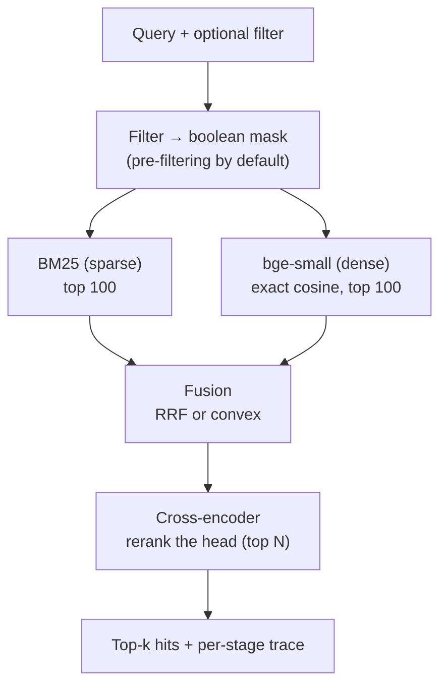

# Hybrid Rerank Retrieval

!!! note "Dense, hybrid and rerank results pending a re-run"
    Only the **BM25 numbers are measured** so far. The dense, hybrid and reranked SciFact run was stopped for
    lack of memory; the harness is now resumable and the run will be repeated. Nothing below claims those
    numbers until then. The section to fill in is
    [Dense, hybrid and reranked](#dense-hybrid-and-reranked-pending).

!!! abstract "At a glance"
    **Repository:** [iamsammy-ak/hybrid-rerank-retrieval](https://github.com/iamsammy-ak/hybrid-rerank-retrieval) ·
    pinned at [`b43a6ec`](https://github.com/iamsammy-ak/hybrid-rerank-retrieval/tree/b43a6ecbd07c50621b42f650c3606348cf2c3d93)
    · **Platform role:** first-stage retrieval for the agentic RAG pipeline and for any agent that
    needs documents: keyword and dense search, fusion, reranking and metadata filters.

    **Measured:** a from-scratch BM25 that lands on the published BEIR baseline: nDCG@10 0.677 on SciFact (published
    0.665) and 0.326 on NFCorpus (published 0.325), under a millisecond per query at the median.

## Problem

Keyword search (BM25) is precise on exact terms such as product codes and error numbers but misses paraphrases;
dense embeddings handle the paraphrase and blur the exact term. Retrieval for RAG and support search needs both, a
reranker to put the best answer first, and filters such as "only runbooks from 2023 onwards", inside a latency
budget. The usual advice ("just add a reranker") skips the numbers; this repository builds each stage small enough to
read and measures what each one adds and costs.

## Architecture



## Key mechanisms

**BM25 as sparse linear algebra.** Every (document, term) BM25 weight is precomputed into a CSC matrix whose columns
are posting lists, so a query is one sparse matrix-vector product that touches only the query terms' columns
([`bm25.py` L114-L119](https://github.com/iamsammy-ak/hybrid-rerank-retrieval/blob/b43a6ecbd07c50621b42f650c3606348cf2c3d93/src/hybrid_retrieval/bm25.py#L114-L119)):

```python
def score(self, query: str) -> np.ndarray:
    """BM25 score of every document for ``query`` (zeros where no query term occurs)."""
    term_ids, counts = self.query_vector(query)
    if term_ids.size == 0:
        return np.zeros(self.n_docs, dtype=np.float32)
    return np.asarray(self._weights[:, term_ids] @ counts).ravel()
```

**Reciprocal rank fusion needs no score calibration**
([`fusion.py` L45-L60](https://github.com/iamsammy-ak/hybrid-rerank-retrieval/blob/b43a6ecbd07c50621b42f650c3606348cf2c3d93/src/hybrid_retrieval/fusion.py#L45-L60)):

```python
def rrf(rankings: Sequence[Ranked], k: float = 60.0, weights: Sequence[float] | None = None) -> Ranked:
    """Reciprocal Rank Fusion of any number of ranked lists."""
    ...
    positions = np.concatenate([r.positions for r in parts])
    contrib = np.concatenate([w / (k + np.arange(1, len(r) + 1, dtype=np.float64))
                              for r, w in zip(rankings, weights, strict=True) if len(r)])
    unique, inverse = np.unique(positions, return_inverse=True)
    fused = np.bincount(inverse, weights=contrib, minlength=unique.size)
    return _sorted(unique, fused)
```

**Rerank the head, keep the tail.** The cross-encoder rescores only the first N fused hits and the rest keep their
fused order below them, so N is a pure latency knob and Recall@100 stays comparable across depths.

**Pre-filtering by default.** The filter mask is applied inside each retriever before its top-k, so a selective
filter still returns a full page; post-filtering throws away retrieved candidates (in the demo, 3 hits survive
post-filtering where pre-filtering returns 5).

## Measured results

### BM25 on BEIR (measured)

Sources: [`bm25_scifact.md`](https://github.com/iamsammy-ak/hybrid-rerank-retrieval/blob/b43a6ecbd07c50621b42f650c3606348cf2c3d93/benchmarks/results/bm25_scifact.md) /
[`bm25_scifact.json`](https://github.com/iamsammy-ak/hybrid-rerank-retrieval/blob/b43a6ecbd07c50621b42f650c3606348cf2c3d93/benchmarks/results/bm25_scifact.json) and
[`bm25_nfcorpus.md`](https://github.com/iamsammy-ak/hybrid-rerank-retrieval/blob/b43a6ecbd07c50621b42f650c3606348cf2c3d93/benchmarks/results/bm25_nfcorpus.md) /
[`bm25_nfcorpus.json`](https://github.com/iamsammy-ak/hybrid-rerank-retrieval/blob/b43a6ecbd07c50621b42f650c3606348cf2c3d93/benchmarks/results/bm25_nfcorpus.json) at `b43a6ec`. Default parameters k1 = 0.9, b = 0.4, fixed before the sweep.

| Dataset | Method | nDCG@10 | Recall@100 | MRR@10 | p50 ms | Published BM25 nDCG@10 |
|---|---|---:|---:|---:|---:|---:|
| SciFact (5,183 docs, 300 queries) | BM25, light stemming | **0.677** | **0.912** | 0.647 | 0.8 | 0.665 |
| | BM25, no stemming | 0.665 | 0.886 | 0.632 | 0.8 | |
| NFCorpus (3,633 docs, 323 queries) | BM25, light stemming | **0.326** | **0.245** | 0.525 | 0.6 | 0.325 |
| | BM25, no stemming | 0.313 | 0.234 | 0.516 | 0.5 | |

The published column is the BEIR paper's BM25 baseline (Thakur et al., 2021), cited rather than measured. Across a
5 × 5 grid of (k1, b), nDCG@10 stays within 0.667-0.684 on SciFact: BM25 is not where quality hides.

### Dense, hybrid and reranked (pending)

Not measured yet: the run is pending a re-run (it was stopped for lack of memory and is now resumable). The
harness reports BM25, dense (float32 and int8), RRF and convex fusion, hybrid + cross-encoder
at depths 10/20/30/50, ablations, a pre- vs post-filtering experiment and the nDCG@10-vs-p95-latency Pareto frontier
on SciFact. When the run finishes, this section gets its table and the cost model's
[support task](../cost.md) can cite a measured reranking latency.

<!-- To fill in after the re-run: a table of nDCG@10, Recall@100, MRR@10 and p50 / p95 ms per method from
     benchmarks/results/scifact.{json,md} at the new pinned commit, the Pareto chart, and the headline pointers
     in bench/manifest.yaml (hybrid-rerank-retrieval, modes.full.headline). -->

## Trade-offs

- **Exact dense search instead of an approximate index**: about two million multiply-adds per query at 5,000
  documents is cheap and loses nothing; past roughly a million vectors an HNSW or IVF index is the better trade.
- **RRF as the default, convex blend as the option**: RRF needs no calibration; a convex blend can do better, but only
  with an `alpha` tuned on held-out data.
- **No positional index**: no phrase queries, in exchange for a two-array persisted index.
- **Light English stemming** is worth about +0.012 nDCG@10 on SciFact and is English-only.

## Failure modes

| Failure | What happens | Where it is handled |
|---|---|---|
| Query is only an error code or a product id | Dense retrieval blurs it | BM25 side of the fusion |
| Paraphrase with no shared words | BM25 misses it | Dense side of the fusion |
| Selective metadata filter | Post-filtering returns short pages | Pre-filtering applied inside each retriever |
| Index built with one embedder, queried with another | Silent garbage | `HybridIndex.load` refuses a different query embedder |
| Passages longer than 512 tokens | Cross-encoder truncates | Not handled; chunk before indexing |

## What I would change at scale

1. **An HNSW index behind the same interface**, with a recall-vs-latency comparison against exact search.
2. **Append-only segments with periodic merges** so adding documents is not a rebuild.
3. **Tune fusion weights on a held-out split** and report the test score once.
4. **A learned sparse retriever (SPLADE)** as a third first-stage list.
