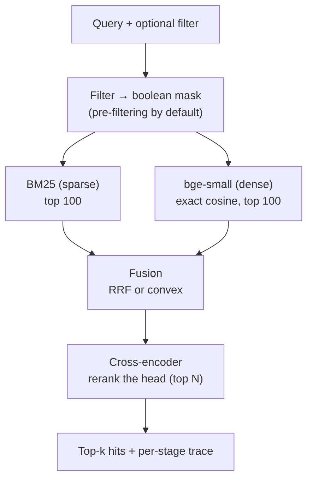

# Hybrid Rerank Retrieval

!!! abstract "At a glance"
    **Repository:** [iamsammy-ak/hybrid-rerank-retrieval](https://github.com/iamsammy-ak/hybrid-rerank-retrieval) ·
    pinned at [`8c7300d`](https://github.com/iamsammy-ak/hybrid-rerank-retrieval/tree/8c7300d8a31f79088883937bfe4a6352ceeeb9a7)
    · **Platform role:** first-stage retrieval for the agentic RAG pipeline and for any agent that
    needs documents: keyword and dense search, fusion, reranking and metadata filters.

    **Measured (BEIR SciFact, test split, 300 queries):** hybrid RRF reaches nDCG@10 0.718 and Recall@100 0.968,
    against 0.677 / 0.912 for BM25 and 0.713 / 0.942 for dense retrieval, for 0.9 ms more at the 95th percentile than
    dense alone. A MiniLM cross-encoder on the top 10 *lowered* nDCG@10 to 0.706 and added 1.6 s. The from-scratch
    BM25 lands on the published BEIR baseline (0.677 vs 0.665 on SciFact, 0.326 vs 0.325 on NFCorpus).

## Problem

Keyword search (BM25) is precise on exact terms such as product codes and error numbers but misses paraphrases;
dense embeddings handle the paraphrase and blur the exact term. Retrieval for RAG and support search needs both, a
reranker to put the best answer first, and filters such as "only runbooks from 2023 onwards", inside a latency
budget. The usual advice ("just add a reranker") skips the numbers; this repository builds each stage small enough to
read and measures what each one adds and costs.

## Architecture



## Key mechanisms

**BM25 as sparse linear algebra.** Every (document, term) BM25 weight is precomputed into a CSC matrix whose columns
are posting lists, so a query is one sparse matrix-vector product that touches only the query terms' columns
([`bm25.py` L114-L119](https://github.com/iamsammy-ak/hybrid-rerank-retrieval/blob/8c7300d8a31f79088883937bfe4a6352ceeeb9a7/src/hybrid_retrieval/bm25.py#L114-L119)):

```python
def score(self, query: str) -> np.ndarray:
    """BM25 score of every document for ``query`` (zeros where no query term occurs)."""
    term_ids, counts = self.query_vector(query)
    if term_ids.size == 0:
        return np.zeros(self.n_docs, dtype=np.float32)
    return np.asarray(self._weights[:, term_ids] @ counts).ravel()
```

**Reciprocal rank fusion needs no score calibration**
([`fusion.py` L45-L60](https://github.com/iamsammy-ak/hybrid-rerank-retrieval/blob/8c7300d8a31f79088883937bfe4a6352ceeeb9a7/src/hybrid_retrieval/fusion.py#L45-L60)):

```python
def rrf(rankings: Sequence[Ranked], k: float = 60.0, weights: Sequence[float] | None = None) -> Ranked:
    """Reciprocal Rank Fusion of any number of ranked lists."""
    ...
    positions = np.concatenate([r.positions for r in parts])
    contrib = np.concatenate([w / (k + np.arange(1, len(r) + 1, dtype=np.float64))
                              for r, w in zip(rankings, weights, strict=True) if len(r)])
    unique, inverse = np.unique(positions, return_inverse=True)
    fused = np.bincount(inverse, weights=contrib, minlength=unique.size)
    return _sorted(unique, fused)
```

**Rerank the head, keep the tail.** The cross-encoder rescores only the first N fused hits and the rest keep their
fused order below them, so N is a pure latency knob and Recall@100 stays comparable across depths.

**Pre-filtering by default.** The filter mask is applied inside each retriever before its top-k, so a selective
filter still returns a full page; post-filtering throws away retrieved candidates (in the demo, 3 hits survive
post-filtering where pre-filtering returns 5).

## Measured results

### BM25 on BEIR (measured)

Sources: [`bm25_scifact.md`](https://github.com/iamsammy-ak/hybrid-rerank-retrieval/blob/8c7300d8a31f79088883937bfe4a6352ceeeb9a7/benchmarks/results/bm25_scifact.md) /
[`bm25_scifact.json`](https://github.com/iamsammy-ak/hybrid-rerank-retrieval/blob/8c7300d8a31f79088883937bfe4a6352ceeeb9a7/benchmarks/results/bm25_scifact.json) and
[`bm25_nfcorpus.md`](https://github.com/iamsammy-ak/hybrid-rerank-retrieval/blob/8c7300d8a31f79088883937bfe4a6352ceeeb9a7/benchmarks/results/bm25_nfcorpus.md) /
[`bm25_nfcorpus.json`](https://github.com/iamsammy-ak/hybrid-rerank-retrieval/blob/8c7300d8a31f79088883937bfe4a6352ceeeb9a7/benchmarks/results/bm25_nfcorpus.json) at `8c7300d`. Default parameters k1 = 0.9, b = 0.4, fixed before the sweep.

| Dataset | Method | nDCG@10 | Recall@100 | MRR@10 | p50 ms | Published BM25 nDCG@10 |
|---|---|---:|---:|---:|---:|---:|
| SciFact (5,183 docs, 300 queries) | BM25, light stemming | **0.677** | **0.912** | 0.647 | 0.8 | 0.665 |
| | BM25, no stemming | 0.665 | 0.886 | 0.632 | 0.8 | |
| NFCorpus (3,633 docs, 323 queries) | BM25, light stemming | **0.326** | **0.245** | 0.525 | 0.6 | 0.325 |
| | BM25, no stemming | 0.313 | 0.234 | 0.516 | 0.5 | |

The published column is the BEIR paper's BM25 baseline (Thakur et al., 2021), cited rather than measured. Across a
5 × 5 grid of (k1, b), nDCG@10 stays within 0.667-0.684 on SciFact: BM25 is not where quality hides.

### The full pipeline on SciFact (measured)

Source: [`scifact.md`](https://github.com/iamsammy-ak/hybrid-rerank-retrieval/blob/8c7300d8a31f79088883937bfe4a6352ceeeb9a7/benchmarks/results/scifact.md) /
[`scifact.json`](https://github.com/iamsammy-ak/hybrid-rerank-retrieval/blob/8c7300d8a31f79088883937bfe4a6352ceeeb9a7/benchmarks/results/scifact.json) at `8c7300d` (5,183 abstracts, 300 judged queries;
`bge-small-en-v1.5` and `ms-marco-MiniLM-L-6-v2` on CPU, one query at a time, on a laptop shared with other work).

| Method | nDCG@10 | Recall@100 | MRR@10 | p50 ms | p95 ms |
|---|---:|---:|---:|---:|---:|
| BM25 | 0.677 | 0.912 | 0.647 | 0.7 | 0.9 |
| Dense (bge-small) | 0.713 | 0.942 | 0.682 | 18.1 | 27.9 |
| Dense, int8 index | 0.715 | 0.942 | 0.685 | 23.0 | 32.6 |
| **Hybrid RRF (k=60)** | **0.718** | **0.968** | 0.686 | 19.0 | 28.8 |
| Hybrid convex (α=0.5, min-max) | 0.733 | 0.972 | 0.701 | 19.0 | 28.8 |
| Hybrid convex (α=0.5, z-score) | 0.734 | 0.972 | 0.701 | 19.0 | 29.0 |
| Hybrid RRF + rerank@10 | 0.706 | 0.968 | 0.672 | 1,544 | 1,610 |
| Hybrid RRF + rerank@50 | 0.694 | 0.968 | 0.661 | 7,560 | 7,858 |


How to read it:

- **Hybrid wins, nearly for free.** RRF lifts nDCG@10 by 0.005 over dense and 0.041 over BM25, and Recall@100 to
  0.968, for 0.9 ms more at the 95th percentile than dense alone: BM25 costs under a millisecond and fusion 0.2 ms.
  Dense retrieval (mostly embedding the query) is where the time goes.
- **Reranking is not on the Pareto frontier here.** The MS MARCO cross-encoder lowered nDCG@10 at every depth
  (0.706 at 10, 0.694 at 50) while adding 1.5-7.6 s per query on CPU. Its training data are web passages, not
  scientific claims, and it truncates at 512 tokens; whatever the cause, "just add a reranker" was wrong on this
  dataset, and only measuring showed it.
- **Fusion settings matter about as much as the choice to fuse, and were swept on the test split.** RRF's `k` moves
  nDCG@10 between 0.716 (k=200) and 0.734 (k=1); the convex blend reaches 0.729-0.736 for α between 0.5 and 0.7. The
  defaults (k=60, α=0.5) were fixed before the sweep; the best cells are test-split sensitivity, not tuned results.
- **int8 costs nothing in quality** (0.715 vs 0.713) and shrinks the index 4x (7.96 MB → 1.99 MB), but was not faster
  on this CPU. Dropping the BGE query instruction scored slightly *better* (0.720), another default worth measuring.
- **Pre-filtering keeps pages full.** With a filter keeping 2% of the corpus, post-filtering filled 1% of top-10
  pages (3.7 hits on average); pre-filtering filled all of them.

## Trade-offs

- **Exact dense search instead of an approximate index**: about two million multiply-adds per query at 5,000
  documents is cheap and loses nothing; past roughly a million vectors an HNSW or IVF index is the better trade.
- **RRF as the default, convex blend as the option**: RRF needs no calibration; the convex blend did better on SciFact
  (0.733 vs 0.718), but only an `alpha` chosen on held-out data would make that a fair claim.
- **No reranker by default**: on SciFact the cross-encoder cost 1.5 s or more per query and lowered quality; it stays an
  option to measure per domain, not a default stage.
- **No positional index**: no phrase queries, in exchange for a two-array persisted index.
- **Light English stemming** is worth about +0.012 nDCG@10 on SciFact and is English-only.

## Failure modes

| Failure | What happens | Where it is handled |
|---|---|---|
| Query is only an error code or a product id | Dense retrieval blurs it | BM25 side of the fusion |
| Paraphrase with no shared words | BM25 misses it | Dense side of the fusion |
| Selective metadata filter | Post-filtering returns short pages | Pre-filtering applied inside each retriever |
| Index built with one embedder, queried with another | Silent garbage | `HybridIndex.load` refuses a different query embedder |
| Passages longer than 512 tokens | Cross-encoder truncates | Not handled; chunk before indexing |
| Reranker trained on another domain | Lower quality at high latency (SciFact: 0.718 → 0.706, +1.6 s p95) | Measured per dataset; reranking is opt-in |

## What I would change at scale

1. **An HNSW index behind the same interface**, with a recall-vs-latency comparison against exact search.
2. **Append-only segments with periodic merges** so adding documents is not a rebuild.
3. **Tune fusion weights on a held-out split** and report the test score once.
4. **A learned sparse retriever (SPLADE)** as a third first-stage list.
5. **A domain-matched or smaller reranker** (or none), chosen on a held-out split against the fused baseline.
