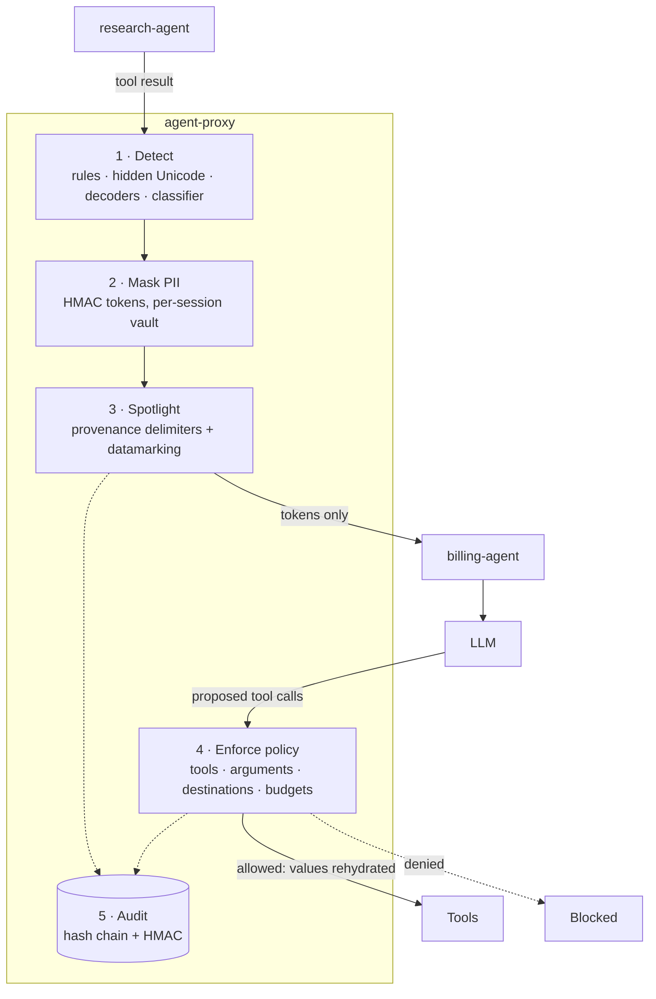

# Inter-Agent Security Proxy

!!! abstract "At a glance"
    **Repository:** [iamsammy-ak/inter-agent-security-proxy](https://github.com/iamsammy-ak/inter-agent-security-proxy) ·
    pinned at [`d2ad5b5`](https://github.com/iamsammy-ak/inter-agent-security-proxy/tree/d2ad5b5b66bc524c70a2d14d5d7b3097109062fa)
    · **Platform role:** the trust boundary on every edge where one agent's output becomes another agent's input.

    **Measured:** injection F1 0.924 on the public deepset test split (bge-small classifier); PII F1 0.969 with
    precision 1.000 on a synthetic English/Italian corpus; about 3.7 ms to screen a short message with the
    download-free classifier.

## Problem

In a multi-agent system one agent's tool result becomes another agent's prompt. That text can carry personal data
the next agent (and the model provider behind it) has no need to see, and instructions planted by an attacker in a
web page or a CRM notes field. The receiving model cannot reliably tell data from commands. Asking every agent to
defend itself fails silently; one checkpoint on the path between agents makes the defences consistent, testable and
audited, and limits what an agent that *does* fall for an injection can do.

## Architecture



## Key mechanisms

**Deterministic, session-scoped HMAC tokens.** The same value maps to the same token within a session (so
multi-turn conversations stay coherent) and to unrelated tokens across sessions (so tokens cannot be joined)
([`pii/vault.py` L102-L120](https://github.com/iamsammy-ak/inter-agent-security-proxy/blob/d2ad5b5b66bc524c70a2d14d5d7b3097109062fa/src/agent_proxy/pii/vault.py#L102-L120)):

```python
def tokenize(self, session_id: str, pii_type: PIIType, value: str) -> str:
    canon = canonical(pii_type, value)
    with self._lock:
        session = self._session(session_id)
        existing = session.by_value.get((pii_type, canon))
        if existing is not None:
            return existing
        message = pii_type.value.encode("utf-8") + b"\x00" + canon.encode("utf-8")
        digest = hmac.new(session.key, message, hashlib.sha256).hexdigest()
        length = self.token_hex
        token = f"<{pii_type.value}_{digest[:length]}>"
        while token in session.by_token:  # truncated-HMAC collision with a different value: lengthen
            length = min(64, length * 2)
            token = f"<{pii_type.value}_{digest[:length]}>"
        ...
```

**Rehydrate only at the tool boundary, only for allowed calls.** Models see tokens; real values reappear in the
arguments of a call the policy allowed, and only for a principal holding `pii:reveal`
([`policy.py` L279-L289](https://github.com/iamsammy-ak/inter-agent-security-proxy/blob/d2ad5b5b66bc524c70a2d14d5d7b3097109062fa/src/agent_proxy/policy.py#L279-L289)):

```python
allowed = not reasons
execute_arguments = None
if allowed:
    with self._lock:
        self._calls[(session_id, agent_id, call.name)] += 1
    if principal.has_scope(SCOPE_PII_REVEAL):
        execute_arguments = self._rehydrate_args(session_id, principal, call.arguments)
    else:
        execute_arguments = call.arguments
```

Arguments are judged by what their tokens stand for, so `send_email(to="<EMAIL_4f2e152f>")` is refused when the
hidden address is outside the allowlist, even though the model never saw it.

**A hash-chained audit log.** Each record carries the previous record's hash, an optional HMAC over its own hash, and
no raw personal values
([`audit.py` L88-L111](https://github.com/iamsammy-ak/inter-agent-security-proxy/blob/d2ad5b5b66bc524c70a2d14d5d7b3097109062fa/src/agent_proxy/audit.py#L88-L111)):

```python
body = {
    "seq": self._seq + 1,
    "ts": datetime.now(timezone.utc).isoformat(timespec="milliseconds"),
    "event": event, "actor": actor, "session": session,
    "data": json.loads(canonical_json(data)),
    "prev": self._head,
}
digest = record_hash(body)
mac = hmac.new(self._key, digest.encode("ascii"), hashlib.sha256).hexdigest() if self._key else None
```

**Rules combine as a noisy-OR** (`1 - Π(1 - w)`), so one strong signal or two moderate ones cross the 0.5
threshold ([`injection/rules.py`](https://github.com/iamsammy-ak/inter-agent-security-proxy/blob/d2ad5b5b66bc524c70a2d14d5d7b3097109062fa/src/agent_proxy/injection/rules.py)).

## Measured results

Sources: [`injection.md`](https://github.com/iamsammy-ak/inter-agent-security-proxy/blob/d2ad5b5b66bc524c70a2d14d5d7b3097109062fa/benchmarks/results/injection.md),
[`pii.md`](https://github.com/iamsammy-ak/inter-agent-security-proxy/blob/d2ad5b5b66bc524c70a2d14d5d7b3097109062fa/benchmarks/results/pii.md),
[`latency.md`](https://github.com/iamsammy-ak/inter-agent-security-proxy/blob/d2ad5b5b66bc524c70a2d14d5d7b3097109062fa/benchmarks/results/latency.md).

| Prompt-injection detection | deepset test (public, 116 texts): P / R / F1 | Synthetic agentic suite: recall / false positives |
|---|---:|---:|
| Rules | 1.000 / 0.333 / 0.500 | 0.692 / 0.175 |
| Classifier (bge-small) | 0.932 / 0.917 / 0.924 | 0.567 / 0.475 |
| Rules + classifier (bge-small) | 0.932 / 0.917 / 0.924 | 0.858 / 0.550 |
| Rules + classifier (hashing, no download) | 1.000 / 0.717 / 0.835 | 0.733 / 0.300 |

| PII detection (synthetic, 600 sentences, 909 spans, 498 hard negatives) | Precision | Recall | F1 |
|---|---:|---:|---:|
| Regex + validators | 1.000 | 0.940 | 0.969 |
| + spaCy person names | 0.899 | 0.921 | 0.910 |

| Latency per message (busy laptop CPU) | Short: p50 | Long tool result: p50 |
|---|---:|---:|
| Full screening, hashing classifier | 3.7 ms | 184 ms |
| Full screening, bge-small classifier | 34.4 ms | 5,624 ms |

## Trade-offs

- **The two detectors fail differently.** The classifier misses hidden channels (it reads visible text; 33% recall
  on tag-character smuggling); the rules catch every tag-character and bidi attack but miss paraphrased social
  engineering. Keeping both, with evidence per signal, explains each verdict.
- **The classifier does not transfer to tool output.** Trained on short user questions, it flags 48% of benign agent
  messages, which is why the default action is `sanitize` (spotlight, audit, pass on) and blocking is opt-in.
- **The embedding classifier is the latency cost**: milliseconds per short message, seconds per 5 KB tool result.
  The hashing twin keeps screening at a few milliseconds at a recall cost.
- **HMAC tokens instead of format-preserving encryption**: masked values that look real invite a model to use them.

## Failure modes

| Failure | What happens | Where it is handled |
|---|---|---|
| Model obeys an injection that slipped past detection | Proposes a malicious tool call | The deterministic tool policy refuses it (shown in the demo) |
| Injection hidden in Unicode tags, bidi controls or base64 | Invisible to the classifier | Rules decode and re-scan hidden channels |
| PII in an unusual spelling (`name [at] example [dot] com`) | Passes unmasked | Not handled: every recall miss in the benchmark is such a spelling |
| Audit file edited, truncated or rewritten | Tampering | Chain catches edits and reordering; HMAC catches a full rewrite; pinned head catches truncation |
| Proxy restart | Token vault and session budgets lost | Not handled: single process, in-memory vault |
| Streaming response requested | Refused | By design until streaming screening exists |

## What I would change at scale

1. **Recalibrate on real benign traffic.** The 48% false-positive rate on agent messages is the first thing to fix:
   refit the threshold (or the classifier) on logged benign tool output, and try a multilingual embedding model.
2. **An encrypted, shared vault and budget store** so several proxy instances can run side by side and survive
   restarts.
3. **Measure attack success end to end** with live models, with and without spotlighting; detection rates alone do
   not say how often a real model follows an injection.
4. **Ship the audit chain to append-only storage** (object lock or a transparency log) and pin the head externally.
