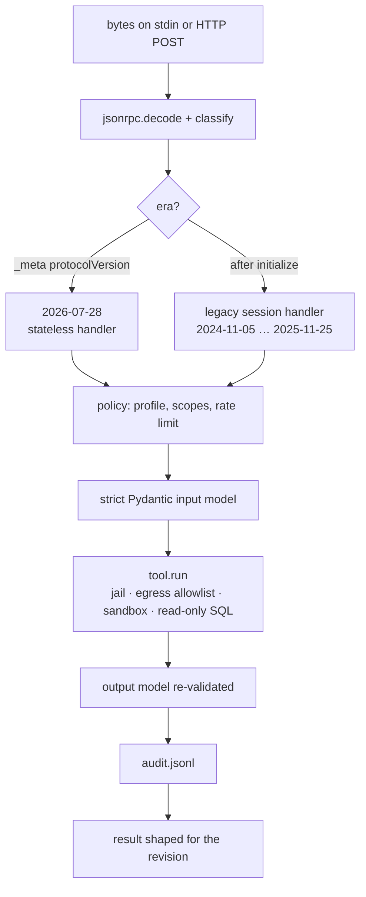

# Raw MCP Tool Server

!!! abstract "At a glance"
    **Repository:** [iamsammy-ak/raw-mcp-tool-server](https://github.com/iamsammy-ak/raw-mcp-tool-server) ·
    pinned at [`1cfc10e`](https://github.com/iamsammy-ak/raw-mcp-tool-server/tree/1cfc10ed5a7f643fada223d85b4e6b3bbf660dab)
    · **Platform role:** the tool plane. Agents reach files, a database, the web and a Python sandbox only through
    Model Context Protocol (MCP) calls that are scoped, validated and audited.

    **Measured:** 10,000 fuzz cases with 0 crashes, 0 internal errors and 0 non-JSON-RPC lines on stdout; 21 of 21
    attack scenarios that ran were refused or contained; a `tools/call` round trip of about 1.1 ms against 4.0 ms for
    the official SDK server doing the same work.

## Problem

An MCP SDK makes a tool server a few decorators long, and that is the problem when it has to be secured: the parts
that decide what happens under attack are hidden. MCP tools are called by a language model, so anything that can
reach the model's context can try to steer those calls. A tool server needs the controls a public API would have:
authenticated callers, least privilege, input validation, rate limits, isolation for risky work and an audit trail.

## Architecture



## Key mechanisms

**Every protocol difference lives in one feature table.** Batching, structured output, annotations and whether an
argument error is a tool error or a protocol error are flags per revision
([`versions.py` L38-L68](https://github.com/iamsammy-ak/raw-mcp-tool-server/blob/1cfc10ed5a7f643fada223d85b4e6b3bbf660dab/src/rawmcp/versions.py#L38-L68)):

```python
@dataclass(frozen=True)
class Revision:
    """Feature flags for one protocol revision."""

    version: str
    modern: bool
    batching: bool
    """JSON-RPC batches: added in 2025-03-26, removed again in 2025-06-18."""
    tool_annotations: bool
    structured_output: bool
    icons_and_descriptions: bool
    input_errors_as_tool_errors: bool
    """SEP-1303 (2025-11-25+): argument validation failures are tool execution errors
    (``isError: true``) rather than JSON-RPC ``-32602`` protocol errors."""


REVISIONS: dict[str, Revision] = {
    "2026-07-28": Revision("2026-07-28", True, False, True, True, True, True),
    "2025-11-25": Revision("2025-11-25", False, False, True, True, True, True),
    "2025-06-18": Revision("2025-06-18", False, False, True, True, False, False),
    "2025-03-26": Revision("2025-03-26", False, True, True, False, False, False),
    "2024-11-05": Revision("2024-11-05", False, False, False, False, False, False),
}
```

**A filesystem jail that resolves before it checks.** Absolute paths, drive letters and `~` are refused outright;
everything else is joined to the root, fully resolved with `realpath` (following symlinks) and checked for
containment
([`jail.py` L39-L65](https://github.com/iamsammy-ak/raw-mcp-tool-server/blob/1cfc10ed5a7f643fada223d85b4e6b3bbf660dab/src/rawmcp/jail.py#L39-L65)):

```python
def resolve(self, user_path: str) -> Path:
    """Return the real, absolute path for ``user_path`` or raise ``JailError``."""
    ...
    if (
        user_path.startswith(("/", "\\", "~"))
        or _DRIVE_RE.match(user_path)
        or PurePosixPath(user_path).is_absolute()
        or PureWindowsPath(user_path).is_absolute()
        or PureWindowsPath(user_path).drive
    ):
        raise JailError("absolute paths are not allowed; use a path relative to the workspace")
    candidate = Path(os.path.realpath(self.root / user_path))
    if not self.contains(candidate):
        raise JailError(f"path {user_path!r} resolves outside the workspace")
    return candidate
```

**Deny by default, and hide what a caller cannot call.** A YAML policy maps profiles and hashed bearer tokens to
scopes (`fs:read`, `fs:write`, `net:fetch`, `exec:python`, `db:read`); `tools/list` is filtered by scope and marked
`cacheScope: "private"`. Policy refusals come back as tool errors (`isError: true`) a model can read; malformed
requests stay JSON-RPC errors because no retry with the same intent fixes them.

**Pydantic models are the schema.** Each tool's strict input model (`extra="forbid"`) becomes its `inputSchema`, its
output model its `outputSchema`, and `structuredContent` is re-validated before it is sent, so the advertised schema
cannot drift from the checks.

## Measured results

Sources: [`stdio_benchmark.md`](https://github.com/iamsammy-ak/raw-mcp-tool-server/blob/1cfc10ed5a7f643fada223d85b4e6b3bbf660dab/benchmarks/results/stdio_benchmark.md),
[`fuzz_campaign.md`](https://github.com/iamsammy-ak/raw-mcp-tool-server/blob/1cfc10ed5a7f643fada223d85b4e6b3bbf660dab/benchmarks/results/fuzz_campaign.md),
[`permission_matrix.md`](https://github.com/iamsammy-ak/raw-mcp-tool-server/blob/1cfc10ed5a7f643fada223d85b4e6b3bbf660dab/benchmarks/results/permission_matrix.md)
(busy Windows laptop; absolute timings pessimistic).

| stdio, one request in flight | p50 ms | p95 ms |
|---|---:|---:|
| rawmcp · `calculate` (2026-07-28) | 1.08 | 1.29 |
| rawmcp · `calculate` (2025-11-25 session) | 1.06 | 1.29 |
| rawmcp · `sqlite_query` join | 5.00 | 10.10 |
| rawmcp · `run_python` sandbox | 305.15 | 389.57 |
| Official SDK server · `calculate` (2026-07-28) | 4.02 | 7.76 |

| Robustness | Result |
|---|---:|
| Fuzz cases (random bytes, mutated requests, nesting to 3,000, 200 KB bodies) | 10,000 |
| Server crashes · internal errors (`-32603`) · non-protocol stdout lines | 0 · 0 · 0 |
| Attack scenarios refused or contained (traversal, SSRF to `169.254.169.254`, `import socket`, `DROP TABLE`, ...) | 21 of 21 that ran |
| Pipelined throughput at 64 in flight, rawmcp vs SDK | 1,155 vs 119 calls/s |

## Trade-offs

- **Two protocol eras cost a second code path**, kept small by the feature table; serving only 2026-07-28 would be
  unreachable for most hosts in use, serving only 2025-11-25 is already legacy.
- **A subprocess sandbox, honestly labelled**: rlimits, a scrubbed environment and an audit hook raise the bar but are
  not a security boundary; containers or gVisor would be, at the price of a Docker dependency.
- **`run_python` is dominated by process start-up** (305 ms median on Windows), which is the cost of isolation.
- **Static bearer tokens** instead of the OAuth 2.1 flow: fine on localhost, not for a shared deployment.

## Failure modes

| Failure | What happens | Where it is handled |
|---|---|---|
| `../`, absolute path, drive letter or escaping symlink | Read or write outside the workspace | Jail: refused before any file operation |
| Allowlisted host resolving to a private or metadata address | Server-side request forgery | Every resolved address must be public; redirects re-checked |
| DNS rebinding between the check and the connection | Address could switch | Not handled: `urllib` resolves again (pinning is on the roadmap) |
| Untrusted Python | Escape attempts | Separate process, timeout, POSIX rlimits, audit hook blocking network and process modules |
| Truncated, deeply nested or batched garbage | Crash or stdout pollution | Strict framing; 0 crashes in 10,000 fuzz cases |
| Model sends wrong argument types | Tool misbehaves | Strict Pydantic validation; a tool error the model can fix on recent revisions |

## What I would change at scale

1. **OAuth 2.1 resource-server mode** with protected-resource metadata and audience-bound tokens.
2. **A container-backed sandbox** (nsjail or gVisor) with no network namespace.
3. **Elicitation before destructive calls** such as `write_file`.
4. **Pin `fetch_url` connections** to the address that passed the public-address check.
