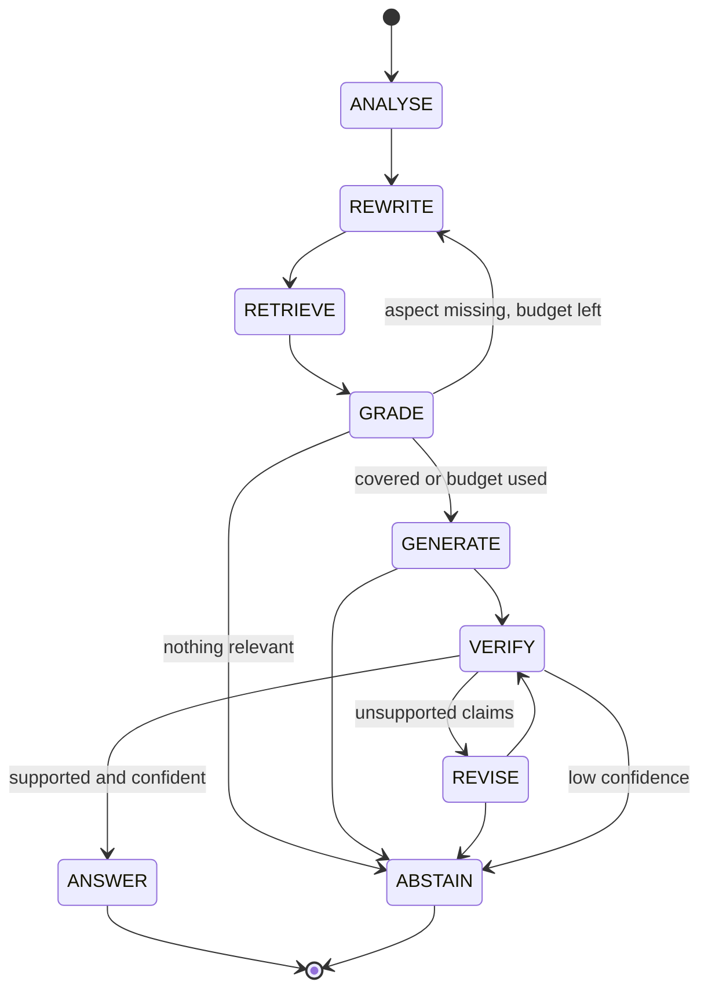

# Self-Correcting Agentic RAG

!!! abstract "At a glance"
    **Repository:** [iamsammy-ak/self-correcting-agentic-rag](https://github.com/iamsammy-ak/self-correcting-agentic-rag) ·
    pinned at [`e84144b`](https://github.com/iamsammy-ak/self-correcting-agentic-rag/tree/e84144b098876e7718e2e5e5c1043c02fe045298)
    · **Platform role:** the answer engine: plans retrieval, checks evidence, checks its own writing, and refuses
    when it should.

    **Measured (synthetic handbook, 69 test questions, no LLM):** wrong answers on 4.3% of questions instead of
    27.5% for naive RAG; the verifier flags 94.6% of seeded hallucinations (all error types) at an 8.7%
    false-alarm rate.

## Problem

Plain retrieval-augmented generation retrieves a few passages and answers from them, whatever they say. Asked when
the Lisbon office opened, it quotes the Lisbon office's opening hours, with a citation. Asked a question that needs
two documents, it stops after the first. The answer looks grounded because it cites a source, but the source does
not say what the answer claims.

## Architecture



## Key mechanisms

**An explicit, enforced transition table.** No agent framework: a dictionary of allowed transitions and one handler
per state. An illegal transition raises, and every step records where it went and why
([`pipeline.py` L54-L66](https://github.com/iamsammy-ak/self-correcting-agentic-rag/blob/e84144b098876e7718e2e5e5c1043c02fe045298/src/agentic_rag/pipeline.py#L54-L66),
[L150-L164](https://github.com/iamsammy-ak/self-correcting-agentic-rag/blob/e84144b098876e7718e2e5e5c1043c02fe045298/src/agentic_rag/pipeline.py#L150-L164)):

```python
TRANSITIONS: dict[State, frozenset[State]] = {
    State.ANALYSE: frozenset({State.REWRITE}),
    State.REWRITE: frozenset({State.RETRIEVE}),
    State.RETRIEVE: frozenset({State.GRADE}),
    State.GRADE: frozenset({State.REWRITE, State.GENERATE, State.ABSTAIN}),
    State.GENERATE: frozenset({State.VERIFY, State.ABSTAIN}),
    State.VERIFY: frozenset({State.REVISE, State.ANSWER, State.ABSTAIN}),
    State.REVISE: frozenset({State.VERIFY, State.ABSTAIN}),
    State.ANSWER: frozenset(),
    State.ABSTAIN: frozenset(),
}
...
while state not in TERMINAL:
    if len(trace) >= MAX_STEPS:
        raise TransitionError(f"no terminal state after {MAX_STEPS} steps")
    next_state, reason, detail = self._handlers[state](run)
    if next_state not in TRANSITIONS[state]:
        raise TransitionError(f"{state.value} -> {next_state.value} is not an allowed transition")
```

**A consistency gate on numbers, names and negation.** Relevance models judge topic, not truth: replacing "26" with
"28" leaves a claim just as relevant. Each claim is scored against units of its cited passage, and the best unit must
also contain the claim's numbers, dates and entities and match its negation parity
([`verify.py` L96-L111](https://github.com/iamsammy-ak/self-correcting-agentic-rag/blob/e84144b098876e7718e2e5e5c1043c02fe045298/src/agentic_rag/verify.py#L96-L111)):

```python
numbers, dates = extract_numbers(claim), extract_dates(claim)
entities = self._claim_entities(claim)
parity = negation_parity(claim)
for i in chosen:
    unit = units[i]
    scope = unit.scope
    missing_numbers = sorted((numbers - extract_numbers(scope)) | (dates - extract_dates(scope)))
    missing_entities = [e for e in entities if not mentions(e, scope)]
    anchor = max(unit.sentences, key=lambda s: overlap(claim_terms, content_terms(s)))
    mismatch = negation_parity(anchor) != parity
    support = W_CROSS_ENCODER * ce[i] + W_LEXICAL * lexical[i]
```

**Diagnosis-driven rewriting.** The grader says why an aspect is missing (a role with no name behind it, an unknown
entity, no relevant passage) and the rewriter answers that gap: "the Chief Financial Officer" triggers *Who is the
Chief Financial Officer?*. The loop is bounded at two rewrites.

**Abstention as a fitted probability.** A logistic regression over seven run features, with the threshold chosen on
a dev split for a 10% target risk, decides borderline cases.

## Measured results

Source: [`benchmark-models.md`](https://github.com/iamsammy-ak/self-correcting-agentic-rag/blob/e84144b098876e7718e2e5e5c1043c02fe045298/benchmarks/results/benchmark-models.md)
(53 synthetic pages, 199 questions split 80 / 50 / 69; `bge-small` + MiniLM cross-encoder; both pipelines use the
same offline extractive writer, so differences come from the pipeline).

| Test split (69 questions) | Naive RAG | Agentic, no gate | **Agentic (full)** |
|---|---:|---:|---:|
| Wrong answers (share of all questions) | 27.5% | 8.7% | **4.3%** |
| Correct outcome (right answer or right abstention) | 72.5% | 91.3% | **92.8%** |
| Abstention precision / recall | n/a / 0% | 100% / 57.1% | **84.6% / 78.6%** |
| Citation precision / recall | 81.8% / 96.8% | 94.4% / 96.8% | **94.2% / 98.3%** |
| AURC (lower is better) | 0.159 | | **0.035** |

| Hallucination detection (280 seeded errors, ≤ 5% clean flags on train) | Overlap only F1 | Cross-encoder only F1 | **Full verifier F1** |
|---|---:|---:|---:|
| Swapped number or date | 0.28 | 0.27 | **0.81** |
| Swapped entity | 0.34 | 0.66 | **0.90** |
| Negation | 0.28 | 0.20 | **0.96** |
| All errors | 0.62 | 0.64 | **0.96** |

Rewrite rounds on the test split: 52 questions needed none, 5 one and 12 two (mean 0.42; used by the
[cost model](../cost.md)). Mean CPU time per question: 1,660 ms agentic, 326 ms naive.

## Trade-offs

- **The gate trades coverage for precision**: it refused one correct multi-part and one correct multi-hop answer,
  which is why answer accuracy drops from 100% (ungated) to 96.4% while wrong answers halve.
- **A similarity cut-off is not a substitute**: on dev, the loosest similarity threshold under the 10% risk target
  answered 8% of questions; near-miss questions retrieve passages that are *very* similar.
- **Strict consistency rejects correct paraphrases** that change a number's form ("€1.2k"); number words, currencies
  and bounds are normalised first, but not everything.
- **Five times the CPU time of naive RAG**, almost all of it embeddings and the cross-encoder.

## Failure modes

| Failure | What happens | Where it is handled |
|---|---|---|
| Near-miss question with a keyword-and-number sentence | Wrong answer (3 of 69 test questions) | Partly: the confidence gate; not fully |
| Question needs a second document | Stops early | GRADE diagnoses the missing aspect, REWRITE targets it (multi-hop 20% → 80%) |
| Draft claims something the citation does not say | Unsupported claim | VERIFY flags it, REVISE drops or re-cites it |
| Nothing relevant retrieved | Would answer from the nearest passage | ABSTAIN with the reason |
| Loop never terminates | Runaway cost | Two-rewrite bound plus `MAX_STEPS = 40` raises |
| LLM generator at temperature 0.1 behind the gateway | Gateway cache bypassed | Integration seam: see the [reference architecture](../architecture.md#integration-seams) |

## What I would change at scale

1. **Benchmark an LLM writer on the same splits** and refit the confidence model on LLM drafts; with copied
   sentences the verifier rarely has anything to catch outside the detection benchmark.
2. **A natural-language-inference model** as a fourth verifier signal for paraphrased claims.
3. **Learnt question analysis** in place of the rule-based answer types and decomposition patterns.
4. **A public multi-hop QA evaluation** (for example HotpotQA distractor) beside the handbook.
