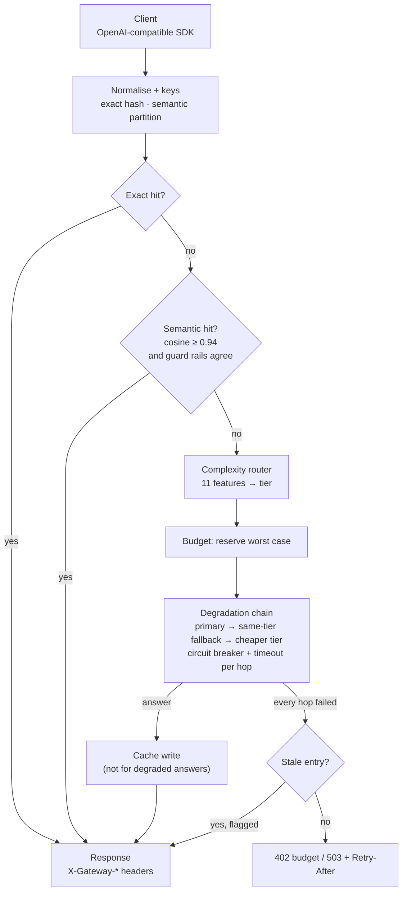

# Semantic Cache Gateway

!!! abstract "At a glance"
    **Repository:** [iamsammy-ak/semantic-cache-gateway](https://github.com/iamsammy-ak/semantic-cache-gateway) ·
    pinned at [`b8b77e0`](https://github.com/iamsammy-ak/semantic-cache-gateway/tree/b8b77e02b5ed88b329e3af6652060544bd4aeb57)
    · **Platform role:** the edge. Every model call leaves through it.

    **Measured (synthetic workload, illustrative prices):** 73.2% cheaper than "always the large model, no cache"
    on the support workload with both caches and the logistic router; 0.4% wrong answers among semantic hits with
    guard rails, against 29.5% without them at the same threshold.

## Problem

Most LLM traffic is not unique, and many prompts do not need the flagship model. Sending everything to the
largest model is the most expensive way to run an LLM feature. The obvious fixes have sharp edges: a semantic cache
that matches on embedding similarity alone answers "convert 8 km to miles" with the cached answer for 5 km, a router
that saves money also sends some hard prompts to a small model, and a gateway in the request path is one more thing
that can fail during a provider outage.

## Architecture



## Key mechanisms

**Guard rails veto look-alike prompts.** A semantic candidate above the threshold is served only if its guard
signature agrees: same numbers, same named entities, same negation, no opposite antonym
([`guards.py` L161-L175](https://github.com/iamsammy-ak/semantic-cache-gateway/blob/b8b77e02b5ed88b329e3af6652060544bd4aeb57/src/cache_gateway/guards.py#L161-L175)):

```python
def conflict(a: GuardSignature, b: GuardSignature) -> str | None:
    """Return the first reason the two prompts must not share an answer, or None if they may."""
    if a.numbers != b.numbers:
        return "numbers"
    if a.entities != b.entities:
        return "entities"
    if a.negated != b.negated:
        return "negation"
    for pair, side in a.polarity:
        if (pair, 1 - side) in b.polarity and (pair, side) not in b.polarity:
            return "polarity"
    ...
    return None
```

**Degraded answers are never cached.** When the chain falls back to a cheaper tier the answer is flagged and not
written to either cache, so an outage cannot keep serving second-best answers for a day
([`gateway.py` L369-L376](https://github.com/iamsammy-ak/semantic-cache-gateway/blob/b8b77e02b5ed88b329e3af6652060544bd4aeb57/src/cache_gateway/gateway.py#L369-L376)):

```python
if role == "cheaper":
    info.degraded, info.degraded_reason = True, f"served by cheaper tier {spec.tier.value}"
    self.metrics.inc("gateway_degraded_total", reason="cheaper_tier")
elif cacheable:  # degraded answers are not cached, so they cannot outlive the outage
    if self.config.cache.exact.enabled:
        self.exact.put(tenant, view.exact_key, answer)
    if vector is not None and view.semantic_text is not None:
        self.semantic.put(tenant, view.partition, view.semantic_text, vector, guard, answer)
```

**Reserve, then settle.** Each hop reserves its worst-case cost before calling the upstream, so concurrent requests
cannot jointly overrun a tenant's limit
([`budget.py` L110-L128](https://github.com/iamsammy-ak/semantic-cache-gateway/blob/b8b77e02b5ed88b329e3af6652060544bd4aeb57/src/cache_gateway/budget.py#L110-L128)):

```python
def reserve(self, tenant: str, amount: float) -> Reservation | None:
    with self._lock:
        if self.kill_switch:
            return None
        account = self._account(tenant)
        if account.limit_usd is not None and account.spent + account.reserved + amount > account.limit_usd:
            return None
        account.reserved += amount
        return Reservation(tenant, amount)
```

**The cache policy is a temperature cap.** Only requests at or below `cache.max_temperature` (0.0 by default) are
cached ([`gateway.py` L126-L129](https://github.com/iamsammy-ak/semantic-cache-gateway/blob/b8b77e02b5ed88b329e3af6652060544bd4aeb57/src/cache_gateway/gateway.py#L126-L129)).
That rule matters when the gateway is composed with the other systems: see
[the reference architecture](../architecture.md#integration-seams).

## Measured results

All from the seeded synthetic workload (3,000 requests per profile), the deterministic mock upstream and the dated,
illustrative price table. Sources:
[`ablation.md`](https://github.com/iamsammy-ak/semantic-cache-gateway/blob/b8b77e02b5ed88b329e3af6652060544bd4aeb57/benchmarks/results/ablation.md),
[`sweep_bge-small.md`](https://github.com/iamsammy-ak/semantic-cache-gateway/blob/b8b77e02b5ed88b329e3af6652060544bd4aeb57/benchmarks/results/sweep_bge-small.md),
[`chaos.md`](https://github.com/iamsammy-ak/semantic-cache-gateway/blob/b8b77e02b5ed88b329e3af6652060544bd4aeb57/benchmarks/results/chaos.md),
[`router.md`](https://github.com/iamsammy-ak/semantic-cache-gateway/blob/b8b77e02b5ed88b329e3af6652060544bd4aeb57/benchmarks/results/router.md),
[`overhead.md`](https://github.com/iamsammy-ak/semantic-cache-gateway/blob/b8b77e02b5ed88b329e3af6652060544bd4aeb57/benchmarks/results/overhead.md).

| Configuration (support workload) | Cache hits | Under-routed | Saving | Saving, narrow prices |
|---|---:|---:|---:|---:|
| Exact cache only | 32.2% | 0% | 27.8% | 27.8% |
| Exact + semantic cache | 47.2% | 0% | 41.5% | 41.5% |
| Routing only (logistic) | 0% | 14.0% | 68.3% | 50.2% |
| Cache + routing (rules) | 47.2% | 4.7% | 69.5% | 61.8% |
| Cache + routing (logistic) | 47.2% | 13.7% | 73.2% | 64.8% |

| Measurement | Value |
|---|---:|
| Wrong answers among semantic hits at threshold 0.94, guard rails on / off | 0.4% / 29.5% |
| Lowest wrong-hit rate reachable with guard rails off, any threshold | about 30% |
| Availability under injected faults: single attempt → full chain | 87.3% → 98.8% |
| Failed upstream calls without / with circuit breakers | 486 / 226 |
| Router fold accuracy, logistic vs rules (180 labelled prompts) | 83.6% vs 82.6% |
| Gateway overhead: exact hit / miss with embedding (median) | 0.38 ms / 43 ms |

## Trade-offs

- **Savings depend on things the gateway does not control.** The exact cache alone saves 27.8% on the FAQ-heavy
  support workload and 13.1% on the assistant workload; the same calls save 73.2% at the illustrative prices and
  64.8% at the narrow ones. The router's contribution is mostly the price gap between tiers.
- **Routing trades money for risk.** The logistic router saves 3.7 points more than the rules router but answers
  13.7% of requests on a smaller tier than the label says they need (rules: 4.7%). No answer quality was measured.
- **The threshold was picked on the workload it is evaluated on**, so the 0.4% wrong-hit rate is in-sample.
- **Circuit breakers cost 0.2 points of availability** (an open circuit also skips a model that just recovered) in
  exchange for half the failed calls and 0.9 s off the 95th percentile.

## Failure modes

| Failure | What happens | Where it is handled |
|---|---|---|
| Paraphrase that changes a lower-case noun ("my manager" vs "my landlord") | Wrong cache hit | Not handled: the guards cannot see it; measured as the residual 0.4% |
| Both models of the small tier down | Small-tier requests have no cheaper tier | Stale cache if one exists, else 503 + `Retry-After` |
| Tenant hits its limit mid-stream of requests | Reservation refused | 402, soft-limit warning and one-tier downgrade before that |
| Outage fills the cache with second-best answers | Prevented | Degraded answers are never written to the cache |
| Gateway restart | Caches, budgets and breaker state are lost | Not handled: single process, in memory |
| Untrusted tenant header | One tenant reads another's partition | Not handled: run behind an authenticating API gateway |

## What I would change at scale

1. **Move state out of the process**: Redis for the exact cache and budgets, a shared vector store for the semantic
   partitions, so replicas agree and a restart does not cold-start the cache.
2. **Grade quality, not labels**: sample routed and cached answers and grade them with a held-out judge, then tune the
   threshold and router against graded outcomes rather than my labels.
3. **Per-tenant protected vocabularies** for the guard rails, learned from traffic, to close the lower-case-noun gap.
4. **Real streaming** with time-to-first-token metrics; the current gateway replays the full answer as server-sent
   events.
5. **Authenticate tenants** at the gateway instead of trusting a header.
