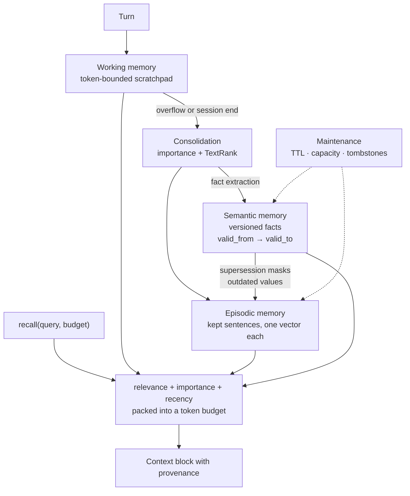

# Three-Tier Agent Memory

!!! abstract "At a glance"
    **Repository:** [iamsammy-ak/three-tier-agent-memory](https://github.com/iamsammy-ak/three-tier-agent-memory) ·
    pinned at [`cf1aea0`](https://github.com/iamsammy-ak/three-tier-agent-memory/tree/cf1aea0cbaf79a991cd3bd69612a435518dd6441)
    · **Platform role:** what the platform remembers about a user across sessions; it feeds the memory slot of the
    context assembler.

    **Measured (synthetic, 50 users × 10 sessions, 450 probes):** recall@5 0.804 vs 0.733 for a flat vector store,
    stale@5 0.224 vs 0.776, with 19.5 stored items per user instead of 151.4. Stale@5 is 0.000 on the probes whose
    statements the offline extractor understood.

## Problem

Agents usually remember in one of two ways, and both break over weeks. Keeping recent history forgets an allergy
mentioned in March by May. Embedding every message in a vector store forgets nothing and updates nothing: "where
does the user live?" returns both "I live in Turin" and "I just moved to Milan", plus a friend in Paris, and the
store grows without bound. Memory for agents needs a short-term buffer, compression, durable facts that know when
they stopped being true, a notion of importance and the ability to forget.

## Architecture



## Key mechanisms

**Close facts, do not overwrite them.** A contradicting statement on a single-valued slot (such as `lives_in`)
closes the old fact's validity interval and links it to its replacement; a late-arriving older statement is filed
as history without disturbing the present
([`semantic.py` L199-L242](https://github.com/iamsammy-ak/three-tier-agent-memory/blob/cf1aea0cbaf79a991cd3bd69612a435518dd6441/src/tiered_memory/semantic.py#L199-L242)):

```python
covering = max(
    (f for f in versions if f.valid_from <= ts and (f.valid_to is None or f.valid_to > ts)),
    key=lambda f: f.valid_from, default=None,
)
following = min((f for f in versions if f.valid_from > ts), key=lambda f: f.valid_from, default=None)
target = normalise_text(fact.object)
if covering is not None and normalise_text(covering.object) == target:
    return self._reinforce(covering, candidate, now=now, importance=importance, action="reinforced")
...
if following is not None:
    fact = fact.model_copy(
        update={"status": "superseded", "valid_to": following.valid_from, "superseded_by": following.id}
    )
self.store.insert_fact(fact, self.embedder.embed([fact.text])[0])
if covering is not None:
    self._close(covering, at=ts, by=fact, now=now)
```

**Time travel falls out of the intervals**
([`semantic.py` L271-L277](https://github.com/iamsammy-ak/three-tier-agent-memory/blob/cf1aea0cbaf79a991cd3bd69612a435518dd6441/src/tiered_memory/semantic.py#L271-L277)):

```python
def as_of(self, ts: float, subject: str = "user") -> list[Fact]:
    """Facts that were valid at time ``ts`` (time travel over the validity intervals)."""
    return [
        f
        for f in self.store.facts(self.namespace, subject=subject, statuses=["current", "superseded"])
        if f.valid_from <= ts and (f.valid_to is None or ts < f.valid_to)
    ]
```

**Supersession reaches the episodes.** At recall time, values that are no longer true anywhere are masked as
`[superseded]` inside episode text, so "it's been raining in Turin all week" stops leaking a city the user has left.

**Scoring and forgetting.** Retrieval score = (1.0 · relevance + 0.3 · importance + 0.2 · recency) × penalty, in the
style of Generative Agents; expiry stretches with importance and reinforcement; eviction leaves a content-free
tombstone (id, tier, reason, content hash).

## Measured results

Source: [`benchmark.md`](https://github.com/iamsammy-ak/three-tier-agent-memory/blob/cf1aea0cbaf79a991cd3bd69612a435518dd6441/benchmarks/results/benchmark.md)
(seed 7, `bge-small-en-v1.5`, 7,568 template-generated turns).

| System | Recall@5 ↑ | Stale@5 ↓ | Recall @ 200 tokens ↑ | Items per user | KB per user |
|---|---:|---:|---:|---:|---:|
| Recency window | 0.042 | 0.000 | 0.227 | 151.4 | 4.4 |
| Flat vector store | 0.733 | 0.776 | 0.849 | 151.4 | 231.5 |
| **Tiered** | **0.804** | **0.224** | **0.878** | **19.5** | **79.3** |
| Tiered without supersession | 0.778 | 0.805 | 0.878 | 19.5 | 79.3 |
| Tiered without eviction | 0.804 | 0.241 | 0.878 | 19.7 | 81.3 |

| Stale@5 split by extraction coverage | All phrasings covered (96 probes) | Some uncovered (78 probes) |
|---|---:|---:|
| Flat vector store | 0.802 | 0.744 |
| Tiered | **0.000** | 0.500 |

Over 40 sessions (10 users) the tiered store levels off at about 18 items (71 KB) per user; without eviction it
reaches 49 items, and the flat store 536.

## Trade-offs

- **Supersession is the feature that removes stale answers** (stale@5 0.22 with it, 0.81 without), and it depends on
  the extractor understanding the update. A missed "these days home is Lyon" leaves the old fact current.
- **Cardinality decides what a contradiction is.** A small explicit predicate vocabulary is testable and cheap;
  unknown predicates default to multi-valued, which never deletes information by mistake but never supersedes either.
- **Sentence-level episode vectors** match single remarks better than one vector per conversation, at the cost of
  more vectors.
- **SQLite with brute-force cosine**: one transactional, inspectable file; fine at ~20 items per user, not at
  millions.

## Failure modes

| Failure | What happens | Where it is handled |
|---|---|---|
| Update phrased in a way the rules do not cover | Old fact stays current (stale answer) | Not handled offline; an LLM extractor is the intended fix |
| Older statement arrives after a newer one | Would overwrite the present | Filed as history with a closed interval (property-tested) |
| Store grows without bound | Recall slows, costs rise | TTL stretched by importance + capacity eviction with tombstones |
| Third-party facts ("my sister lives in Rome") | Not extracted as facts | Kept as episodic text only |
| Outdated value inside an old episode sentence | Leaks into recall | Masked as `[superseded]` at recall time |

## What I would change at scale

1. **LLM extraction behind the same interface**, benchmarked against the rules on the split where they fail (the
   78 uncovered probes), since that is where every remaining stale answer comes from.
2. **Reflection**: periodic summaries that turn related episodes into higher-level facts.
3. **Facts about third parties**, keyed by subject, with the same validity intervals.
4. **Postgres with a vector extension** once namespaces are shared across services; the interval logic ports as-is.
