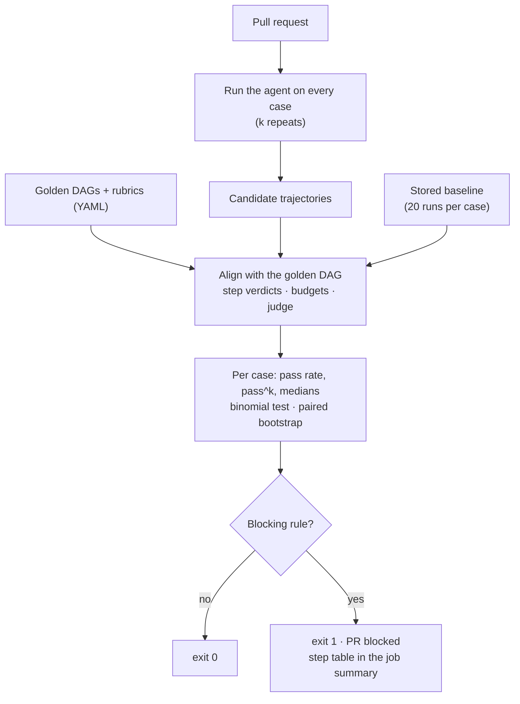

# Trajectory Eval Gate

!!! abstract "At a glance"
    **Repository:** [iamsammy-ak/trajectory-eval-gate](https://github.com/iamsammy-ak/trajectory-eval-gate) ·
    pinned at [`3921cce`](https://github.com/iamsammy-ak/trajectory-eval-gate/tree/3921ccec986ce71b8922398b69a055b9217073cb)
    · **Platform role:** the quality gate in CI. No change to an agent merges if its *journey* regressed.

    **Measured (scripted travel-desk agent, synthetic faults):** the trajectory gate blocked 100% of regressed run
    sets, the outcome-only gate 55.3%; flakiness handling cut blocked benign run sets from 46.4% to 16.5% (pooled),
    and no clean run was ever flagged. Reproduced end to end by this repository's
    [runner](../benchmarks.md).

## Problem

Most agent evaluations score the final answer. That misses the failures that matter in production: an agent that
issues the refund before checking identity, reads card data it should never touch, calls the search tool five times
or skips a policy check and happens to answer correctly anyway. Grading the journey has its own problems: agents
legitimately reorder independent calls and retry flaky tools, LLM judges drift, and runs are stochastic, so one
failing run is not proof of a regression.

## Architecture



## Key mechanisms

**A partial order, not a reference sequence.** A golden DAG states only real dependencies (`verify` and `policy`
both after `booking`, `refund` after both), plus forbidden tools and budgets
([`refund_cancelled.yaml` L3-L49](https://github.com/iamsammy-ak/trajectory-eval-gate/blob/3921ccec986ce71b8922398b69a055b9217073cb/src/trajectory_gate/example/data/golden/refund_cancelled.yaml#L3-L49),
abridged):

```yaml
steps:
  - id: booking
    tool: get_booking
    args: {booking_ref: BK-4F7Q2}
  - id: verify
    description: identity must be verified before money moves
    tool: verify_identity
    args:
      customer_id: C-1002
      method: {one_of: [otp, dob]}
    after: [booking]
  ...
  - id: refund
    tool: issue_refund
    args:
      booking_ref: BK-4F7Q2
      amount: {approx: 189.90, tol: 0.01}
      method: original_payment
    after: [verify, decide]
  ...
forbidden:
  ...
  - tool: get_payment_details
    reason: refunds go to the original payment method; the agent must not read card data
```

**Optimal assignment, then order repair.** The Hungarian algorithm maximises total match quality between golden
nodes and recorded steps; a second pass only swaps between *equally good* occurrences to remove order violations, so
it can never trade a correct argument match for a convenient position
([`align.py` L166-L197](https://github.com/iamsammy-ak/trajectory-eval-gate/blob/3921ccec986ce71b8922398b69a055b9217073cb/src/trajectory_gate/align.py#L166-L197)):

```python
for i, step_index in enumerate(assigned):
    if step_index is None:
        continue
    quality = outcomes[i][step_index].quality
    for j, outcome in enumerate(outcomes[i]):
        if j in used or not outcome.name_ok or abs(outcome.quality - quality) > 1e-9:
            continue
        trial = dict(positions)
        trial[nodes[i].id] = j
        score = _violations(trial, pairs)
        if score < current and (best is None or score < best[2]):
            best = (i, j, score)
```

**Statistics that separate regressions from noise.** A case that never failed in the baseline regresses on any
failure; a case that is already flaky regresses only when a one-sided binomial test says the drop is unlikely under
the baseline pass rate
([`regression.py` L115-L135](https://github.com/iamsammy-ak/trajectory-eval-gate/blob/3921ccec986ce71b8922398b69a055b9217073cb/src/trajectory_gate/regression.py#L115-L135)):

```python
if cand.passes == cand.runs:
    status = "improved" if base.passes == 0 else "ok"
elif base.passes == base.runs:
    status = "regressed"
elif base.passes == 0:
    status = "known_failure"
elif policy.flaky.handle:
    p_value = binom_cdf(cand.passes, cand.runs, base.pass_rate)
    status = "regressed" if p_value < policy.flaky.alpha else "flaky"
```

Score, cost and step rules additionally need the change to pass a threshold *and* a paired bootstrap interval on
per-case medians to exclude zero.

## Measured results

Source: [`benchmark.md`](https://github.com/iamsammy-ak/trajectory-eval-gate/blob/3921ccec986ce71b8922398b69a055b9217073cb/benchmarks/results/benchmark.md)
(baseline 20 runs per case; each candidate run set 3 runs × 5 cases; faults fire with probability 1.0, 0.67 or
0.34, so many are intermittent; offline heuristic judge).

| Regression (run sets) | Trajectory gate | Outcome-only | Faulty runs flagged (gate / outcome) |
|---|---:|---:|---:|
| Skipped identity verification (41) | **100%** | 20% | 100% / 0% |
| Wrong order: action before its check (45) | **100%** | 9% | 100% / 0% |
| Extra costly calls and loops (45) | **100%** | 13% | 100% / 3% |
| Forbidden tool (45) | **100%** | 87% | 100% / 24% |

| Benign variation (45 run sets) | Trajectory gate | Without flakiness handling |
|---|---:|---:|
| Seed noise only | 0% | 29% |
| Transient tool errors and retries | 0% | 47% |
| Independent calls reordered | 11% | 40% |

| Offline judge calibration (81 author-labelled replies) | Value |
|---|---:|
| Accuracy / Cohen's κ | 0.81 / 0.63 |
| Brier score, raw → Platt-scaled | 0.175 → 0.133 |
| Grading time per trajectory, mean (p95) | 6.9 ms (20.5 ms) |

## Trade-offs

- **Someone has to write the DAG.** That is the price of not blocking every harmless reordering.
- **Strict on stable cases by design**: a case that never failed in 20 baseline runs regresses on its first failure,
  so a rare failure mode can still block a pull request.
- **A deterministic judge by default** gives the same verdict on the same input without a key; it reads surface
  features (κ 0.63) and misses wrong meaning stated with the right numbers.
- **Bigger baselines than candidates**: 20 runs recorded once, 3 per pull request, so flakiness can be estimated
  without paying for it on every change. The [cost model](../cost.md) prices this.

## Failure modes

| Failure | What happens | Where it is handled |
|---|---|---|
| Agent reorders independent calls | Would be a false regression | Partial order: only real dependencies are edges |
| Flaky upstream causes retries | Would inflate cost and steps | Failed attempts and the turn reacting to them are excluded; `max_attempts` still catches storms |
| One odd run swings an aggregate | False regression | Per-case medians plus bootstrap intervals |
| Healthy agent is itself flaky on a case | 2-11% of benign run sets blocked | Binomial test; the residue is the pet-policy case answering wrongly |
| Judge drifts or is biased | Wrong verdicts | Calibration against labels, Platt scaling, position-swap and verbosity probes before it may block |
| Eval runs served from a response cache | Regressions and flakiness hidden | Must bypass the gateway cache (see the [cost model](../cost.md)) |

## What I would change at scale

1. **Mine golden DAGs from passing runs** (the common partial order) so writing specs is review, not authoring.
2. **An OpenTelemetry GenAI importer** so production traces become eval cases without custom logging.
3. **Measure the LLM judge's calibration** and add a two-judge agreement check before letting it block.
4. **A pull-request comment** that diffs step verdicts between baseline and candidate.
