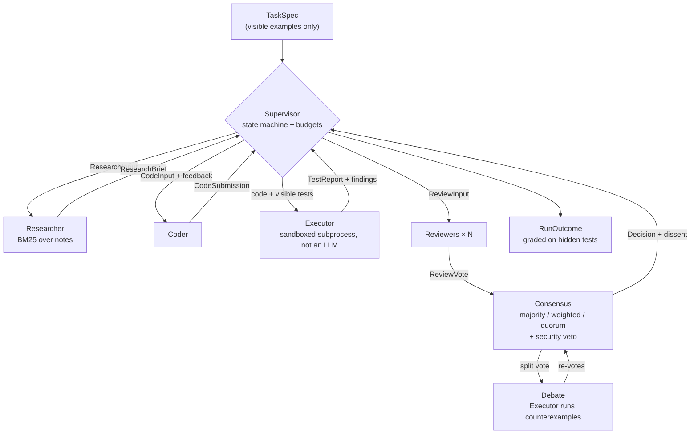

# Typed Multi-Agent Swarm

!!! abstract "At a glance"
    **Repository:** [iamsammy-ak/typed-multi-agent-swarm](https://github.com/iamsammy-ak/typed-multi-agent-swarm) ·
    pinned at [`37b44ec`](https://github.com/iamsammy-ak/typed-multi-agent-swarm/tree/37b44ec34961f5d3879863a284f203e79d06c1c3)
    · **Platform role:** the orchestration layer for tasks that need several roles: research, code, execute,
    review, decide.

    **Measured (offline, simulated agent competence, real execution):** accepted-solution correctness 97.9% with
    three reviewers at accuracy 0.8, against 62.0% for a single coder; a security veto cut insecure approvals from
    20.4% to 5.4% of reviews. The [topology page](../swarm-topologies.md) puts these numbers in context.

## Problem

A single LLM agent that writes code and declares it done fails quietly: it misreads the specification, misses an edge
case or reaches for `eval`, and nothing in the loop notices. Adding agents does not fix that by itself: free-form
text between agents breaks on malformed output, debates go to whoever sounds most confident, and a swarm without
limits burns budget while going in circles.

## Architecture



## Key mechanisms

**The supervisor is a transition table with a budget guard.** Routing is deterministic and every transition is
logged with its reason; before entering a phase the guard checks that the phase's agent calls still fit, so a budget
is never exceeded rather than detected afterwards
([`supervisor.py` L69-L79](https://github.com/iamsammy-ak/typed-multi-agent-swarm/blob/37b44ec34961f5d3879863a284f203e79d06c1c3/src/agent_swarm/supervisor.py#L69-L79),
[L183-L202](https://github.com/iamsammy-ak/typed-multi-agent-swarm/blob/37b44ec34961f5d3879863a284f203e79d06c1c3/src/agent_swarm/supervisor.py#L183-L202)):

```python
ALLOWED_TRANSITIONS: dict[Phase, frozenset[Phase]] = {
    Phase.START: frozenset({Phase.RESEARCH, Phase.CODE, Phase.DONE}),
    Phase.RESEARCH: frozenset({Phase.CODE, Phase.DONE}),
    Phase.CODE: frozenset({Phase.CODE, Phase.EXECUTE, Phase.DONE}),
    Phase.EXECUTE: frozenset({Phase.CODE, Phase.REVIEW, Phase.DONE}),
    Phase.REVIEW: frozenset({Phase.CONSENSUS, Phase.DONE}),
    Phase.CONSENSUS: frozenset({Phase.DEBATE, Phase.TIE_BREAK, Phase.CODE, Phase.DONE}),
    Phase.DEBATE: frozenset({Phase.CONSENSUS, Phase.DONE}),
    Phase.TIE_BREAK: frozenset({Phase.CODE, Phase.DONE}),
    Phase.DONE: frozenset(),
}
...
def guard(self, route: Route) -> Route:
    """Stop the run if the next phase would break a budget."""
    ...
        need = self.calls_needed(target)
        left = budget.max_agent_calls - usage.agent_calls
        if need > left:
            problem = f"{target.value} needs {need} agent call(s) but only {left} remain"
```

**Typed hand-offs with bounded repair.** Agents return text; the hand-off layer validates it against a frozen
Pydantic artifact (code must parse and define the entry point) and sends field-level repair requests a bounded number
of times, each charged to the budget
([`handoff.py` L86-L130](https://github.com/iamsammy-ak/typed-multi-agent-swarm/blob/37b44ec34961f5d3879863a284f203e79d06c1c3/src/agent_swarm/handoff.py#L86-L130)).
The contract itself is described on the [topology page](../swarm-topologies.md#the-typed-hand-off-contract).

**A security veto above any vote count, and log-odds weights from measured reliability**
([`consensus.py` L28-L50](https://github.com/iamsammy-ak/typed-multi-agent-swarm/blob/37b44ec34961f5d3879863a284f203e79d06c1c3/src/agent_swarm/consensus.py#L28-L50)):

```python
def log_odds_weight(reliability: float) -> float:
    """Weight of a reviewer who is right with probability ``reliability``: log(r / (1 - r))."""
    r = min(max(reliability, MIN_RELIABILITY), MAX_RELIABILITY)
    return math.log(r / (1.0 - r))


def find_veto(votes: Sequence[ReviewVote], policy: ConsensusPolicy) -> ReviewVote | None:
    """The first security change request severe enough to veto, if the policy enables vetoes."""
    if not policy.security_veto:
        return None
    for vote in votes:
        if (
            vote.verdict is Verdict.REQUEST_CHANGES
            and vote.category is Category.SECURITY
            and vote.severity.rank >= policy.veto_min_severity.rank
        ):
            return vote
    return None
```

**Debate grounded in execution.** On a split vote (winning side under 75% of cast weight), reviewers attach
counterexamples as literal arguments with an expected value, the Executor runs them, and each reviewer re-votes
seeing the others' rationales and the results.

## Measured results

Source: [`swarm_benchmark.md`](https://github.com/iamsammy-ak/typed-multi-agent-swarm/blob/37b44ec34961f5d3879863a284f203e79d06c1c3/benchmarks/results/swarm_benchmark.md)
(20 tasks × 30 seeds = 600 episodes per configuration; correctness is measured by running the accepted code against
hidden tests; agent competence is simulated).

| Configuration | Accepted-solution correctness (95% CI) | Correct overall | Agent calls / task |
|---|---:|---:|---:|
| Single coder | 62.0% (58.1-65.8) | 62.0% | 2.2 |
| Coder + Executor | 72.2% (68.5-75.7) | 72.0% | 2.3 |
| 1 reviewer @ 0.8 | 90.2% (87.5-92.4) | 85.8% | 4.3 |
| 3 reviewers @ 0.8 | 97.9% (96.4-98.8) | 94.3% | 9.1 |
| 5 reviewers @ 0.8 | 99.7% (98.8-99.9) | 96.8% | 11.5 |

| Mechanism | Without | With |
|---|---:|---:|
| Security veto: insecure submissions approved (3 @ 0.6, 93 reviews) | 19 (20.4%) | 5 (5.4%) |
| Debate, 3 @ 0.7: decision accuracy on split votes | 64.8% | 78.0% |
| Debate, 5 @ 0.7: decision accuracy on split votes | 69.4% | 71.7% |
| Reliability-weighted vs majority (mixed panel): correct overall | 91.8% | 94.8% |

## Trade-offs

- **The numbers measure the orchestration, not any model.** Coder skill and reviewer accuracy are inputs; the shape
  of the results follows from the mechanisms, the absolute levels from the inputs.
- **More reviewers cost more calls**: 4.3 → 9.1 → 11.5 calls per task at accuracy 0.8. The
  [cost model](../cost.md) turns that into dollars per correct solution.
- **Debate helps small panels more than large ones**: for five reviewers it fixed 42 split decisions and broke 36,
  because herding and bogus counterexamples cut both ways.
- **A transition table is less flexible than an LLM manager**, in exchange for auditable runs and budgets enforced
  before the money is spent.

## Failure modes

| Failure | What happens | Where it is handled |
|---|---|---|
| Malformed JSON or a missing field (5% of simulated replies) | Hand-off fails | Field-level `RepairRequest`, at most `max_repairs`, charged to the budget |
| Code that passes visible tests but fails hidden ones | Accepted wrongly | Reviewers; hidden tests grade only afterwards (never inside the swarm) |
| Insecure code (`eval`, path traversal) that passes every test | Approved by majority | Security veto on one credible major finding |
| Reviewers share the same blind spot | Voting stops helping (0 → 5 insecure acceptances at correlation 0.9) | Not handled: different models per reviewer reduce, not remove, it |
| Bogus counterexample in debate | Correct code rejected | Partly: the Executor checks it, but there is no oracle for expected values |
| Runaway loop | Budget burned | Guard checks calls, tokens and wall time before every phase |

## What I would change at scale

1. **Benchmark LLM mode** on the same tasks and compare it with the simulation; that is the test of whether the
   simulated competence model was a fair stand-in.
2. **Run reviewers concurrently** and stream routing events; the panel is sequential today.
3. **A container-based Executor** that shares no process with the test harness.
4. **Learn reviewer reliability online** from graded outcomes instead of a calibration run, and choose reviewer models
   to minimise error correlation, not just maximise accuracy.
